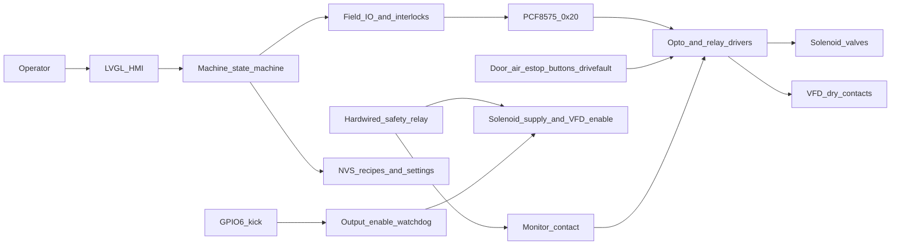
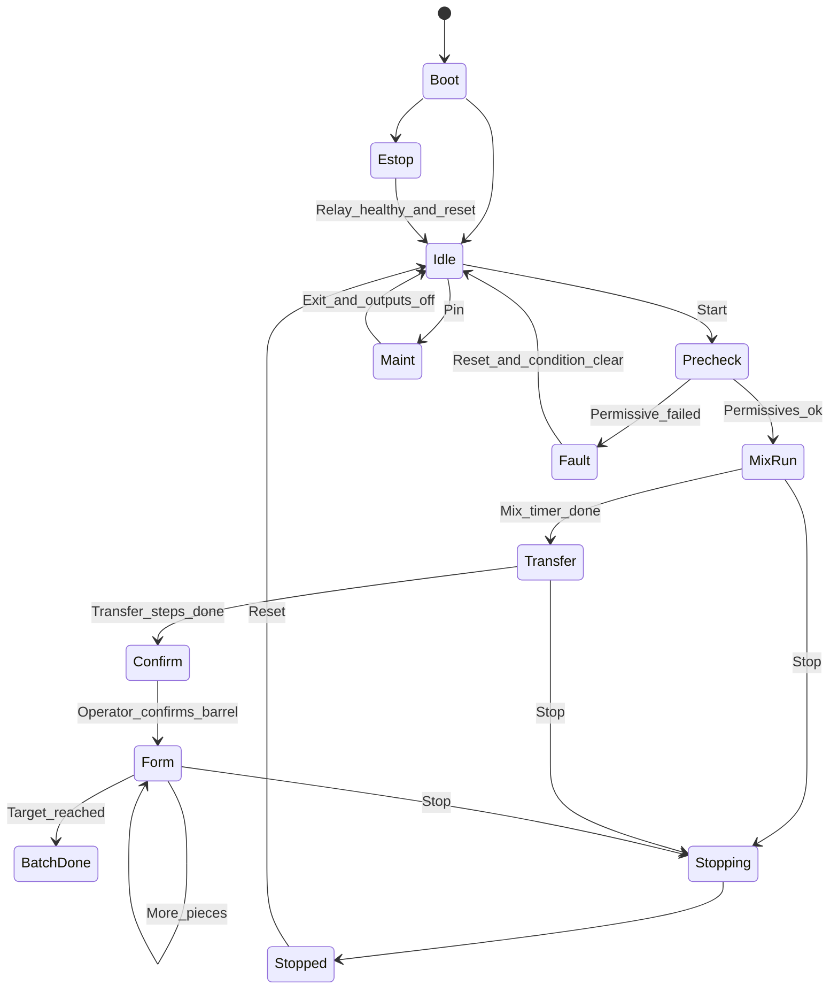

# System Architecture

| Field | Value |
| --- | --- |
| Document | 03-System-Architecture.md |
| Product | Piaya Dough Maker prototype |
| Status | Planning baseline. Firmware is not started. |
| Date | 2026-10-26 |

This document describes how the prototype is divided and how the parts communicate. Behavioral limits are in [02-Technical-Requirements.md](02-Technical-Requirements.md). Pin-level wiring is in [04-Hardware-Design.md](04-Hardware-Design.md). The state table is in [05-Software-Design.md](05-Software-Design.md).

## 1. Control layers

Three layers keep the touchscreen, the field wiring, and the emergency stop apart.

| Layer | Role | What it must not do |
| --- | --- | --- |
| ESP32-S3 on the Waveshare board | HMI, state machine, recipes, timers, counts, calibration math, alarms, diagnostics, NVS | Drive a coil, a 24 V input, or a VFD terminal. Reset the safety relay. Resume a batch after reboot. |
| PCF8575 at `0x20` | Sixteen quasi-bidirectional pins for commands and status | Act as a safety controller. Accept 24 V, a coil, or a VFD terminal on a pin. |
| Interface and safety hardware | Opto inputs, opto drivers, dry contacts, coil suppression, fuses, the safety relay, and the GPIO6 watchdog | Depend on LVGL, I2C, or FreeRTOS for the emergency-stop function. |

The PCF8575 is not an industrial I/O module. Loss of the I2C bus leaves its outputs latched. The watchdog and the safety relay are the hardware responses to that fact. See [04-Hardware-Design.md](04-Hardware-Design.md).

## 2. System block diagram



The safety relay removes energy without a path through the HMI. The monitor contact is a status input so the screen can explain why motion has stopped. The GPIO6 kick is in series with the safety-relay output that feeds field power. It is equipment protection. It is not a second emergency stop and it is not a safety-rated function.

## 3. Firmware components

The tree below is the intended ESP-IDF layout. None of these source files exist yet. Creating them is a later phase in [06-Implementation-Plan.md](06-Implementation-Plan.md).

```text
piaya_dough_maker/
  CMakeLists.txt
  sdkconfig.defaults
  partitions.csv
  main/
    CMakeLists.txt
    app_main.c
  components/
    board/
    pcf8575/
    field_io/
    machine/
    config_store/
    alarm/
    hmi/
    diagnostics/
  test/
```

| Component | Responsibility | Depends on |
| --- | --- | --- |
| `board` | Display, touch, backlight, and the onboard I/O helper, taken from the Waveshare ESP-IDF demo | ESP-IDF LCD and I2C drivers |
| `pcf8575` | Bus init, shadow, write, read, timeout, recovery, simulated backend for tests | ESP-IDF I2C, or a fake bus in host tests |
| `field_io` | Logical names, polarity, coil exclusion, inactive image, permissives applied to outputs | `pcf8575` |
| `machine` | States, timers, VFD run requests, pneumatic requests, batch counts | `field_io`, `config_store`, `alarm` |
| `config_store` | Versioned recipes, machine settings, calibration, maintenance counters | NVS |
| `alarm` | Active alarm and the 32-entry history | `config_store` for the history write, via the diagnostics queue |
| `hmi` | LVGL screens and the keypad | `machine` status snapshot and command queue only |
| `diagnostics` | UART logs and the only task that writes NVS after boot | `config_store` |

`app_main` starts NVS, the board, the safe PCF8575 write, the tasks, and then returns. Widget code cannot include the PCF8575 header.

The original sketch that split pneumatics, VFDs, recipes, settings, calibration, and batch into separate components is folded into `machine` and `config_store`. The behavior stays. The extra libraries do not.

## 4. FreeRTOS tasks and communication

| Task | Priority | Period | Stack | Owns |
| --- | --- | --- | --- | --- |
| I/O | 8 | 10 ms | 4096 bytes | The only I2C transactions to the PCF8575 |
| Machine | 7 | 10 ms | 6144 bytes | State and the next output request |
| LVGL | 4 | 10 ms | At least 8192 bytes, then the size that the Waveshare demo actually uses | Every LVGL call |
| Diagnostics | 2 | event driven | 4096 bytes | Logs and NVS writes after boot |

Priorities are initial values for bring-up. The display's RGB interrupt stays above these tasks, as configured by ESP-IDF. The task watchdog is enabled on the I/O task and the machine task. A stalled control task resets the controller, which stops the GPIO6 kick and removes field power through the watchdog relay.

Queues and shared data:

| Path | Mechanism | Depth or rule |
| --- | --- | --- |
| HMI to machine | Command queue | 8 messages. A full queue rejects the new command and the screen says the command was not accepted. |
| Machine to HMI | Status snapshot under one mutex | HMI copies it out and does not hold the mutex across LVGL layout work. |
| Any task to alarms | Alarm queue | 16 messages |
| Machine or HMI to NVS | NVS request queue | 4 messages, consumed only by diagnostics |

Command messages are plain C structs: start, stop, reset, acknowledge batch, close door, jog press, jog release, save recipe, select recipe, calibration confirm. The machine task validates them against the current state. Invalid commands are ignored and, where [02-Technical-Requirements.md](02-Technical-Requirements.md) requires it, raise `SETTINGS_REJECTED`.

Boot order:

1. Initialize NVS and load configuration, or factory data if the store is bad.
2. Initialize the board, including backlight, without touching field outputs.
3. Initialize the PCF8575 and write `0xFFFF` so every output bit is inactive and every input bit is readable.
4. Start the I/O task and wait until one successful poll, or raise `I2C_IO_FAILURE` and remain in a fault that cannot start.
5. Read permissives. If the safety monitor is unhealthy, enter emergency stop. Otherwise enter idle.
6. Start the LVGL task on the dashboard.

No task blocks while an actuator timer runs. The machine task stores a deadline and checks it on each 10 ms poll.

## 5. State machine overview

Automatic motion is one command at a time. The names below are the states implemented in [05-Software-Design.md](05-Software-Design.md). Transfer and forming are drawn as groups here so the diagram stays readable.



`Transfer` expands to the door, mix, and plunger steps in the product requirements, including the center commands and the optional retracts. `Form` expands to plunge, cut, convey, flatten, count, and the optional plunger retract after the count. `Confirm` waits for the operator because there is no barrel sensor. Idle and the finished-batch screen can run an explicit door-close command. That command is outside the automatic order.

Global transitions, checked before the state's own timer:

| Condition | From | To |
| --- | --- | --- |
| Safety monitor unhealthy | Any state | Estop |
| I2C failure, low air, or drive fault | Any state except Estop | Fault, after writing the inactive image if the bus still accepts it |
| STOP button or on-screen stop | Mix, transfer, confirm, form, door-close | Stopping |
| Maintenance request | Idle only | Maint |
| Reboot | Any | Boot, which does not reload the previous in-progress state |

## 6. Data model

Recipe and machine-setting fields are listed in [02-Technical-Requirements.md](02-Technical-Requirements.md). At runtime the machine holds:

| Object | Contents | Lifetime |
| --- | --- | --- |
| `recipe_snapshot_t` | Copy of the selected recipe taken at precheck | RAM for one batch. Edits do not change it. |
| `motion_limits_t` | Pulse limits, door-close margin, debounce | Copied with the snapshot |
| `output_request_t` | Logical coils and run bits before polarity | RAM, owned by the machine task |
| `output_image_t` | Sixteen bits after polarity and exclusion | RAM, owned by the I/O task |
| `input_image_t` | Last valid read and debounced bits | RAM |
| `batch_progress_t` | Cycles, pieces, target, rejected adjustment, interrupted flag | RAM, checkpointed to NVS at each count |
| `alarm_record_t` | Code, state, text | Active RAM plus a 32-entry NVS ring |
| `maint_counters_t` | Command counts per output | NVS, updated with the batch checkpoint and on jog release |

Schema version is the first field of each stored blob. A mismatch takes the factory path described in the technical requirements.

The theoretical yield is computed for display and is not stored as a guaranteed result:

- Piece estimate = floor(15000 / target grams).
- Cycle estimate = floor(piece estimate / nozzle count).

## 7. Output arbitration

One place computes the bits that will be written:

1. The machine task emits a logical request for the current state or jog.
2. `field_io` clears any opposing pair that is both true, and records a fault if that request came from automatic mode. Maintenance jogs never set both ends of a pair; the second press is rejected.
3. Permissives force the request inactive when the safety monitor is down, air is low, a drive fault is present, or the I/O link has failed.
4. Polarity converts logical active into the pin level. The default writes 0 for active and 1 for inactive.
5. Input bits in the image are written as 1 so they can be read.
6. The I/O task writes the image and reads it back on the next transaction.

The inactive image is `0xFFFF` under the default polarity. Boot writes it before the state machine can request a run.

HMI callbacks stop at the command queue. They do not form bit masks.

## 8. Interlock summary

The full matrix is in [05-Software-Design.md](05-Software-Design.md). The architectural rules are:

- Door open and door close cannot both be active. The same rule binds plunger extend and retract, and cutter extend and retract.
- Mixer run during mix requires the door-closed switch and the common permissives.
- Mixer run during the two transfer-mix steps requires the common permissives and does not require the door switch.
- Conveyor run is allowed in the conveyor step and as a maintenance jog.
- Flattener, cutter, plunger, and door commands are allowed only in their own steps or as maintenance jogs.
- No field output is requested while the safety monitor, air input, drive-fault input, or I/O link is failed.
- Hardware cross-interlocks on the door, plunger, and cutter coil pairs remain even if the software image is wrong. See the hardware document.
- The safety relay is not represented as a software output.

## 9. What this architecture leaves unresolved

Phase 1 still has to identify the onboard helper chip before `board` can be frozen. The VFD terminal names are unresolved before the dry-contact wiring can be built. Cylinder data is unresolved before valves are sized. Those gaps are listed in [06-Implementation-Plan.md](06-Implementation-Plan.md) and are not filled by assumptions in this document.
