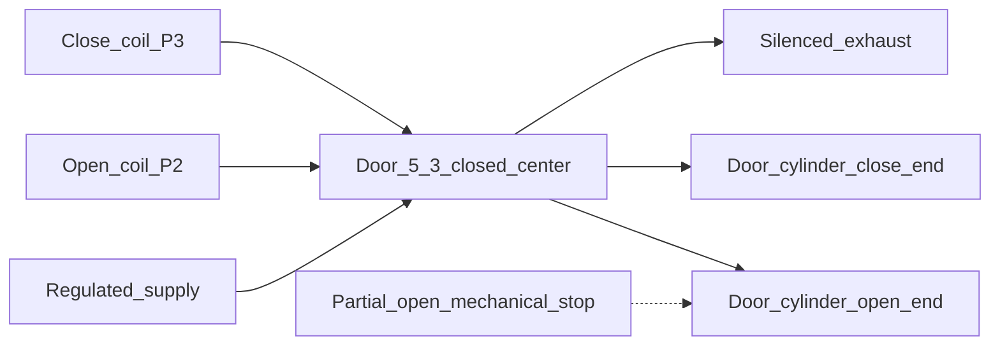
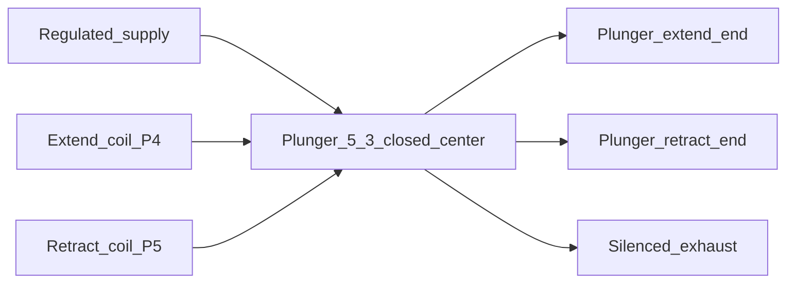
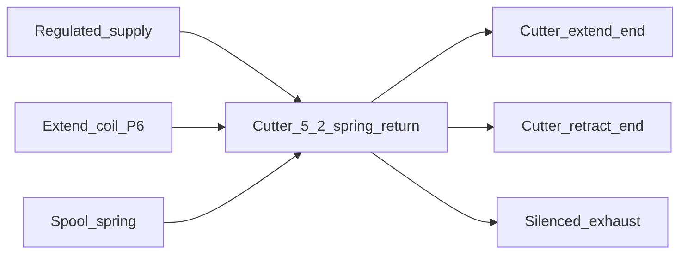
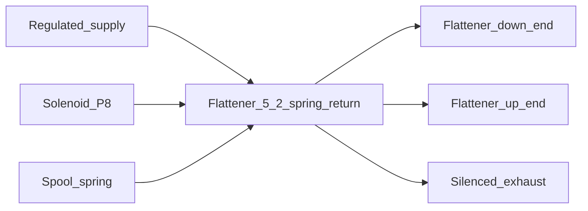

# Hardware Design

| Field | Value |
| --- | --- |
| Document | 04-Hardware-Design.md |
| Product | Piaya Dough Maker prototype |
| Status | Planning baseline. Not a build package until the Open items in section 2 are closed. Phase 1 confirmation is still open. |
| Date | 2026-10-30 |

Labels:

- **Verified** — read from the cited document.
- **Assumption** — used for planning and still unconfirmed.
- **Recommendation** — choice for this prototype.
- **Open** — do not buy, size, or wire from a guess.
- **Client drawing** — transcribed in [07-Client-Drawing-Alignment.md](07-Client-Drawing-Alignment.md). A barrel diameter from that record is not a pneumatic bore, stroke, or valve flow.

No prices are listed. No valve catalog numbers are listed. No safety-standard compliance is claimed for the machine.

## 1. Verified controller

Sources:

- Product page: https://www.waveshare.com/esp32-s3-lcd-7b.htm
- Wiki: https://www.waveshare.com/wiki/ESP32-S3-Touch-LCD-7B
- ESP-IDF guide: https://docs.waveshare.com/ESP32-S3-Touch-LCD-7B/ESP-IDF
- User guide: https://docs.waveshare.com/ESP32-S3-Touch-LCD-7B/Instructions-For-Use
- Schematic PDF: https://files.waveshare.com/wiki/ESP32-S3-Touch-LCD-7B/ESP32-S3-Touch-LCD-7B-Schematic.pdf
- Demo archive: https://files.waveshare.com/wiki/ESP32-S3-Touch-LCD-7B/ESP32-S3-Touch-LCD-7B-Demo.zip
- Espressif flash and PSRAM guide: https://docs.espressif.com/projects/esp-idf/en/v5.5.3/esp32s3/api-guides/flash-psram-config.html

| Item | Value | Status |
| --- | --- | --- |
| Touch product | ESP32-S3-Touch-LCD-7B, SKU 31726 | **Verified** on the product page |
| Non-touch product | ESP32-S3-LCD-7B, SKU 31727 | **Verified**. Wrong board for this project. |
| Module | ESP32-S3-WROOM-1-N16R8 | **Verified** on the product page |
| CPU | Xtensa LX7 dual-core, up to 240 MHz | **Verified** |
| Flash / PSRAM | 16 MB flash, 8 MB PSRAM | **Verified** as capacities. Octal versus quad operation is not proved by the N16R8 name. |
| Radios | 2.4 GHz Wi-Fi and Bluetooth 5 LE | **Verified** present. Unused in this product. |
| Display | 7-inch IPS, 1024 × 600, RGB565, 5-point capacitive touch | **Verified** |
| Board supply | USB-C 5 V. Wiki lists 5 V 350 mA and 0–65 °C. | **Verified** as published board figures, not as the machine load or an enclosure rating. |
| Touch controller | Example function `touch_gt911_init()`, up to 5 points. Address map shows `0x5D`. | **Verified** from the ESP-IDF guide and the user-guide address map |
| Touch pins | IRQ GPIO4. Reset is on the onboard helper, not a free ESP32 GPIO. | **Verified** from the wiki pinout |
| I2C | SDA GPIO8, SCL GPIO9, on the external I2C header. Occupied addresses `0x24` and `0x5D`. | **Verified** |
| Onboard helper | User guide says CH422G. Other reports, including a quoted support reply, say CH32V003 at `0x24` with PWM backlight. | **Open**. Phase 1 reads the demo, the schematic, and the chip mark before any driver is written. |
| Backlight | Example `15_LVGL_SLIDER` adjusts brightness. | **Verified** that the demo exposes brightness. Register address and safe duty are **Open** until that source is read. Third-party limits are not adopted. |
| Free GPIO | Example `01_GPIO` drives GPIO6. | **Verified** as a pin the demo treats as available. Reserved here for the watchdog kick. |
| RS485 | GPIO15 and GPIO16 | **Verified** as the RS485 UART. Not reused until the schematic shows the transceiver can be left out of circuit. |
| USB | GPIO19 and GPIO20 | **Verified**. Stay on USB. The USB/CAN mux is left in USB mode. |
| TF card | GPIO11, GPIO12, GPIO13, chip select on the helper | Unused |
| RGB pins | DE GPIO5, VSYNC GPIO3, HSYNC GPIO46, PCLK GPIO7. R3–R7: GPIO1, 2, 42, 41, 40. G2–G7: GPIO39, 0, 45, 48, 47, 21. B3–B7: GPIO14, 38, 18, 17, 10. | **Verified** from the wiki |
| ESP-IDF examples | `06_LCD`, `08_TOUCH`, `13_lvgl_v8_demo` using LVGL 8.4. A separate `16_lvgl_v9_demo` exists and is not the base. Installer screenshots use ESP-IDF 5.5.2. A performance note also mentions 5.3. | **Verified** as published. The project pins the version the demo archive requires. Expected family 5.5.x. |
| Published `sdkconfig` | 240 MHz, QIO flash, octal PSRAM, 120 MHz flash and PSRAM clocks, experimental features, 64-byte cache line. Waveshare states the flash and PSRAM speeds must match. | **Verified** as Waveshare's list. Espressif marks 120 MHz DDR experimental. Phase 3 soaks the panel and may fall back only to a mode Espressif lists for the chip IDs that are read. |

The Waveshare GitHub README text has called the panel 5-inch. The product page and the wiki specification table say 7-inch, 1024 × 600. Those two pages are the ones this design uses.

HMI orientation is landscape 1024 × 600. **Open:** whether the enclosure mounts the panel the other way. The LCD example can rotate the image after that is known.

## 2. Open items that block a build

- VFD manufacturer, model, and manual for the mixer and the conveyor: digital-input terminals, sink or source, common terminal, enable or STO, fault-relay contact, and whether an output contactor is forbidden.
- Cylinder bore, stroke, orientation, and load for the door, plunger, cutter, and flattener.
- Operating air pressure and the stroke time each cylinder must meet.
- PCF8575 module schematic: pull-up voltage, address straps, level shifters, INT pin.
- Onboard helper identity and backlight register, from the demo source and the schematic.
- GPIO6 header voltage and whether anything else is already on that net.
- Door-switch contact arrangement. The required interface only pulls an expander pin low.
- Whether the flattener or the door falls when air or electrical power is lost.
- Partial-open stop distance: angle or millimetres. The stop itself is required before a dough trial uses the partial-open command. The distance stays blank.
- Enclosure, guards, washdown, and ambient temperature versus the board's published 0–65 °C.
- Coil current and required valve flow. Supply and valve sizing stay blank until those exist.
- Compressor: oil-free or not.

## 3. PCF8575 electrical rules

Sources: TI PCF8575 datasheet SCPS121I (https://www.ti.com/lit/ds/symlink/pcf8575.pdf) and the NXP PCF8575 datasheet (https://www.nxp.com/docs/en/data-sheet/PCF8575.pdf). The module vendor is **Open**. The rules below are the constraints for either silicon family as published by TI for SCPS121I.

| Parameter | Published value | How it is used |
| --- | --- | --- |
| Supply | 2.5–5.5 V | Power the device at 3.3 V from the display board. Do not power it from 5 V. |
| Recommended low sink | 25 mA per P-port | Opto LED current target is 2–5 mA, set by a resistor once Vf is known: `(3.3 - Vf) / If`. |
| Absolute continuous low current | 50 mA per P-port | Not a design operating point. |
| Current through VCC or GND | ±100 mA | Budget the sum of every LED that exclusion logic can light together. |
| Steady high source | Recommended high-level output current is 1 mA in magnitude. The steady-state test current into a grounded pin is hundreds of microamps. | Do not use a pin to source a relay coil or a VFD input. |
| Power-on | All P-ports high | Inactive, for active-low outputs. |
| Structure | Quasi-bidirectional. Write 1 before using a pin as an input. A high forced onto a pin written 0 causes a large sink current. | Field circuits only pull low. They never drive 24 V or a strong high onto a pin. |
| Address | `0100 A2 A1 A0`, 7-bit `0x20`–`0x27` | Use `0x20` with A2, A1, and A0 tied to GND. `0x24` is occupied on this board. |
| Write order | First data byte P00–P07, second data byte P10–P17 | Logical P0–P7 are the first byte. Logical P8–P15 are the second byte. |
| Bus speed | Fast-mode 400 kHz | Share the board bus. INT is open-drain and is left unwired. Inputs are polled. |

**Recommendation:** confirm the purchased module has no pull-up to 5 V and no level shifter that expects 5 V on SDA and SCL. Parallel pull-ups to 3.3 V are acceptable after their resistor values are read. A stuck expander can hold the same bus the touch controller and the backlight helper use. The driver sets an I2C timeout and uses the ESP-IDF bus-recovery procedure. That does not move a latch that can no longer be addressed. Section 8 covers that case.

## 4. I/O map

Logical P0–P15 are the software names. TI names are the datasheet pins. Active level is the voltage on the PCF8575 pin.

| Logical | TI pin | I2C | Direction | Function | Active level |
| --- | --- | --- | --- | --- | --- |
| P0 | P00 | byte 0 bit 0 | Output | Mixer VFD run | Low |
| P1 | P01 | byte 0 bit 1 | Output | Conveyor VFD run | Low |
| P2 | P02 | byte 0 bit 2 | Output | Door open coil | Low |
| P3 | P03 | byte 0 bit 3 | Output | Door close coil | Low |
| P4 | P04 | byte 0 bit 4 | Output | Plunger extend coil | Low |
| P5 | P05 | byte 0 bit 5 | Output | Plunger retract coil | Low |
| P6 | P06 | byte 0 bit 6 | Output | Cutter extend coil | Low |
| P7 | P07 | byte 0 bit 7 | Output | Unused | Written inactive |
| P8 | P10 | byte 1 bit 0 | Output | Flattener solenoid | Low means the solenoid is energized. Down versus up is proved at low pressure. |
| P9 | P11 | byte 1 bit 1 | Input | Door closed | Low means closed |
| P10 | P12 | byte 1 bit 2 | Input | Safety-relay monitor | Low means the relay is in the run state |
| P11 | P13 | byte 1 bit 3 | Input | Air pressure OK | Low means pressure OK |
| P12 | P14 | byte 1 bit 4 | Input | START | Low means pressed |
| P13 | P15 | byte 1 bit 5 | Input | STOP | Low means not pressed. An open wire reads as stop. |
| P14 | P16 | byte 1 bit 6 | Input | Firmware RESET | Low means pressed |
| P15 | P17 | byte 1 bit 7 | Input | Drive fault chain | Low means both drives report healthy |

P15 is accepted. Both drive fault contacts are in series, closed when both drives are healthy, and this pin is low in that state.

P7 is unused and is written inactive. The cutter valve is the spring-return valve in section 9.4.

Shadow initial value is `0xFFFF`. Outputs off, inputs readable. Boot writes that image before any sequence request.

GPIO6 is not in this map. It kicks the output-enable watchdog described in section 6.

## 5. Input and output circuits

### 5.1 Outputs

Each PCF8575 output sinks only an optocoupler LED. The optocoupler transistor switches a 24 V relay or MOSFET that carries the real load. A DC coil gets a flyback diode at the coil. The LED resistor is calculated after the optocoupler datasheet provides Vf. Target current is 2–5 mA.

Door open and door close each pass through a hardware cross-interlock: a normally closed contact of the opposite contactor or an equivalent interlock relay, so both coils cannot be powered if one driver sticks on. The plunger pair is interlocked the same way. The cutter has one coil, on P6. P7 is unused and is written inactive.

VFD run outputs are separate dry contacts. They do not share a relay with a solenoid.

No ESP32 pin and no PCF8575 pin connects to a coil or a VFD terminal.

### 5.2 Inputs

24 V field contacts drive optocoupler modules. The module output is an open collector that may only pull the PCF8575 pin toward the expander ground. The expander pin is written high so its weak pull-up is the idle level.

Fail-safe contact sense, so a broken wire matches the unsafe condition:

| Input | Field contact |
| --- | --- |
| Door closed | Closed when the door is closed |
| Safety monitor | Closed only while the safety relay is in the run state |
| Air OK | Closed when pressure is above the switch point |
| STOP | Closed when the button is not pressed |
| Drive fault | Closed when the drive fault relays are healthy, both drives in series |
| START and firmware RESET | Closed only while pressed |

The safety monitor is not the device that stops the machine. Section 6 is that device.

### 5.3 Power, grounding, and cable separation

**Assumption:** one 24 V DC control supply. Its current rating is **Open** until coil currents are known. Size it for every coil the interlocks allow at the same time, with spare capacity. The number is not invented here.

The display board is powered at 5 V on its USB-C port from a supply that remains on with the control system. A laptop is a programming supply, not the batch supply.

Motor power and VFD output cables stay physically separated from the I2C cable and from the 3.3 V header. The I2C run is short and paired. If a shield is used, it is grounded at the board end only.

Protective earth of the motors and drives follows the drive manuals. The 24 V field common and the 3.3 V logic common meet at one defined point on the interface modules, on the optocoupler output side, and nowhere else. Exact terminal bonding is completed when the module schematics exist.

Fuses: one fuse for the safety-relay and contactor control, and separate fuses for solenoid groups. Ampere values are **Open** until coil currents are known.

## 6. Safety circuit and watchdog

Candidate relay: Pilz PNOZ X2.8P, 24 V AC/DC, order number 777301. Operating manual 1004082-EN-24: https://www.pilz.com/download/open/PNOZ_X2_8P_Operat_Manual_1004082-EN-24.pdf

**Verified** from that manual for this order: 24 V AC/DC supply, two input channels, manual or automatic start, three normally open safety contacts (13-14, 23-24, 33-34), one normally closed auxiliary (41-42). When the relay is active the three safety contacts are closed and 41-42 is open. When the input circuit opens, the safety contacts open and 41-42 closes. The manual describes a start circuit that includes S12-S34. Pilz states that the relay meets EN 60947-5-1 and EN 60204-1 for the relay's intended use. That sentence does not certify this machine. The full terminal diagram in the Pilz manual is the wiring reference. This document does not redraw it.

Functional use on this machine:

- Dual-channel normally closed emergency-stop buttons into the relay input.
- Manual reset on the relay. Releasing the emergency-stop button does not by itself restore energy.
- One normally open safety contact enables the 24 V feed for solenoid drivers and for the VFD-interface relay coils.
- One normally open safety contact drives the VFD STO or enable path the VFD manual requires.
- One normally open safety contact is the P10 monitor. It is closed only in the run state.
- Auxiliary 41-42 is not the monitor. It is closed in the tripped state, so a broken wire on that contact would look like a healthy machine if the firmware expected the opposite.

The controller cannot reset this relay and has no output that substitutes for it.

**VFD stop path, Open until the manuals arrive.** If the selected drive provides STO, the safety contact drives STO. If it does not, the safety contact drives the enable or coast-stop terminal the manual names. A contactor on the drive output is not added unless that manual allows it. A line-side contactor is specified only after the same reading. Drive parameters must disable automatic restart after power returns.

**GPIO6 watchdog, accepted equipment protection for this prototype.** GPIO6 pulses an external timeout relay whose contact is in series with the safety relay's field-power contact. If the controller stops pulsing, field outputs lose 24 V even while the PCF8575 still holds a low. The watchdog contact is not in parallel with the safety relay. The watchdog part number and the timeout are **Open**. This function is equipment protection. It is not claimed as a safety channel.

## 7. VFD interface

**Assumption:** each drive can run from a dry contact on its digital input. **Open:** the terminal names, the common terminal, sink versus source, and the fault-relay polarity.

Design that stays valid until the manuals arrive:

- Mixer run is a relay contact controlled from P0. Conveyor run is a separate relay contact controlled from P1.
- The contact closes to request run and opens to request stop.
- Contact rating must exceed the drive input current published in that drive's manual. The current is not guessed here.
- The relay coil is 24 V, driven by the opto stage, and is inside the safety-relay and watchdog supply so an emergency stop or a dead controller drops the run request.
- P15 is the series combination of the two drives' fault contacts, closed when both are healthy.
- No Modbus, no analog output, and no encoder are added for this prototype.
- Speed is whatever the drive keypad holds. Firmware does not display a measured speed.

Until both manuals are filed, any drawing that names a drive terminal is a placeholder and is not for construction.

## 8. Behavior when energy or communication is lost

De-energizing a coil is not assumed to be a safe mechanical position. The motion that follows depends on the valve.

| Event | Electrical result | Mechanical result with air still present | Mechanical result with air gone |
| --- | --- | --- | --- |
| Normal stop | Firmware opens both run contacts and writes every solenoid bit inactive. | Door and plunger 5/3 valves go to closed center and can drift. Flattener moves to the spring-plumbed end. With air present, the cutter spool returns toward retract when the coil drops. | Cylinders drift with load. Firmware cannot finish a stroke. Loss of air does not prove the cutter blade moved. |
| Emergency stop | Safety relay removes solenoid 24 V and the VFD enable or STO path. Firmware reports it. | Same valve result as coil power loss, and the motors lose their enable. | Same drift. The motors are without enable. |
| Mains loss | Coils drop. Drives lose power. | Same as coil power loss until air also bleeds down. | Drift. On restore, drives must not auto-restart, the safety relay waits for its manual reset, and firmware boots to idle. |
| Air loss | Pressure input faults the sequence and removes run commands. | Commands stop. Motion already in progress is not completed under control. | No commanded motion. |
| ESP32 reset | PCF8575 keeps the last lows until boot writes `0xFFFF` or the GPIO6 watchdog opens the field supply. | A coil that was on can stay on for that interval unless the watchdog has already opened. | Drift. |
| I2C failure | Firmware faults, retries the inactive image, and relies on the watchdog if the retry cannot be sent. Software cannot flip a pin after the device stops acknowledging. | Unknown if a coil was on. | Drift. |

The HMI must not describe any of these positions as confirmed, except the door-closed switch when that input is actually low.

## 9. Pneumatics

### 9.1 Supply

**Recommendation:** lockable shutoff, filter, regulator, gauge, and a lockable isolation and exhaust point for maintenance. No lubricator, because the product is food and oil mist is a contamination path. Oil-free compressor status is **Open**. Exhaust silencers on valve exhaust ports. Meter-out flow controls are the expected way to set speed. Orifice size is **Open**.

Valve flow is not selected until bore, stroke, pressure, and required time are known.

### 9.2 Mixer door

**Recommendation, matching the process proposal:** 5/3 double-solenoid, spring-centered, closed center. One coil opens, the other closes, both off commands center.

Center blocks the ports. It does not lock the piston. A partial opening needs a mechanical stop, and the open timer only has to be long enough to reach that stop. The piston can still creep. The closed switch is the only measured position, and it is true only at the closed end.

Software and the hardware cross-interlock keep the two coils off together.

### 9.3 Plunger

Same valve type as the door. Extend coil from P4, retract coil from P5, both off commands center.

A forming pulse ends in center somewhere along the stroke. That position is not repeatable. Piece mass is calibrated by weight. See [05-Software-Design.md](05-Software-Design.md).

### 9.4 Cutter

**Current design:** 5/2 single-solenoid, spring return. P6 energizes the solenoid. With air present, the spring-selected port is retract, so coil off drives the spool toward retract. P7 is unused and is written inactive. Loss of air does not prove the blade moved. The client sheet shows a shutter and does not show this valve. See [07-Client-Drawing-Alignment.md](07-Client-Drawing-Alignment.md).

The detented 5/2 double-solenoid is the rejected alternative. There is no cutter sensor. A jam or a short stroke is not detected.

### 9.5 Flattener

**Recommendation:** 5/2 single-solenoid, spring return. P8 energizes the solenoid. The spring returns the spool, not the piston by itself. With air present, the cylinder is driven to the end plumbed to the rest position. **Recommendation to prove at low pressure:** rest position is up, energized position is down. With air absent, a heavy tool can fall. If the mechanical review says it can fall, a restraint or a pilot-operated check is required before operation. That hardware is **Open**.

### 9.6 Conveyor

The conveyor is an electric drive, not a cylinder. It runs for the recipe time and then the run contact opens. No encoder is added unless a later approval says so.

## 10. Failure analysis

Detection, the required response, and the extra hardware that would be stronger are listed together. Alarm text and the firmware recovery steps are in [05-Software-Design.md](05-Software-Design.md).

| Failure | Detection | Required response | Prototype limit | Stronger hardware |
| --- | --- | --- | --- | --- |
| Emergency stop | P10 opens. The relay has already dropped energy. | Firmware latches emergency stop and writes outputs inactive as a backup. | Monitor wire failure only hides the message if miswired. Use a run-state normally open contact. | Safety-rated installation per a risk assessment. Not claimed here. |
| Mains loss | Seen on the next boot | Idle. No resume. Drives parameterized not to restart. Relay needs its manual reset. | Motion during the outage is unknown. | Stored-energy design for any axis that falls. **Open.** |
| ESP32 reset | Boot, plus loss of the GPIO6 kick | Watchdog drops field 24 V. Boot writes `0xFFFF`. Interrupted count is display-only. | Until the watchdog times out, a latched low can hold a coil. | The watchdog itself. Contact feedback is still absent. |
| PCF8575 or I2C failure | Transaction timeout | Fault, retry inactive image, watchdog if the retry cannot be sent. | Position unknown. Touch and backlight share this bus. | A separate I2C port is not available on a verified free header. |
| Stuck output driver | Not detected | Hardware cross-interlock blocks the opposite coil only. | The stuck direction can remain on until a fuse or the safety relay opens. | Auxiliary-contact readback. Not in this prototype. |
| Solenoid or valve failure | Not detected, except door close timeout | Door close that misses the switch faults. Other axes finish their timers and the screen says the timer elapsed. | False position claims are forbidden. | End-of-stroke switches. |
| Low air | P11 opens | Fault and commands off. | Cylinders can drift. | A dump valve only after the gravity review. Dumping air is not assumed safe. |
| Drive fault | P15 opens | Fault and commands off. | There is still no proof the shaft was turning before the contact opened. | A motor sensor. Not in this prototype. |
| Cutter obstruction | None | Timer still completes. | Called out on the manual screen. Accepted for the prototype. | A pressure or position switch. |
| Invalid or corrupt settings | Validation and NVS checks | Refuse start. Factory data. Commissioned cleared on corruption. | The last good process times may be gone. | A second stored copy. Not in this prototype. |
| Stop during motion | STOP input or screen | Stopping, then Stopped. No partial-cycle count. | With air present, the cutter spool returns toward retract when the coil drops. Loss of air does not prove the blade moved. | A cutter sensor. Not in this prototype. |
| Reboot during a batch | Interrupted-batch flag | Show the last completed count. Do not continue. | Dough position is unknown to the controller. | Operator procedure only. |

## 11. Bill of materials

Ratings are only those read from a document. Blank sizing fields stay blank. Prices are omitted.

| Function | Candidate | Ratings that were read | Document | Alternative |
| --- | --- | --- | --- | --- |
| HMI controller | Waveshare ESP32-S3-Touch-LCD-7B, SKU 31726 | 16 MB flash, 8 MB PSRAM, 1024 × 600 RGB, GT911 at `0x5D`, I2C on GPIO8/GPIO9, 5 V USB-C | Section 1 links | None for this project. SKU 31727 has no touch. |
| Field expander | A PCF8575 module whose schematic is reviewed first | TI SCPS121I: 2.5–5.5 V, power-on high, quasi-bidirectional, address `0x20`–`0x27`, 25 mA recommended sink | https://www.ti.com/lit/ds/symlink/pcf8575.pdf | NXP PCF8575 if the module uses that die. Same address and power-on rules must be checked on that datasheet. |
| Emergency-stop relay | Pilz PNOZ X2.8P order 777301 | 24 V AC/DC, 3 NO safety contacts, 1 NC auxiliary, two channels, manual or automatic start | Manual 1004082-EN-24 | Another relay with the same contact behavior, after its manual is read. |
| 24 V supply | Class only | Current **Open** | Select after coil currents | — |
| 24 V opto input modules | Class only | Output must be open-collector compatible with a 3.3 V expander pin | Review the module schematic before wiring | Discrete optocouplers |
| Solenoid drivers | Opto plus 24 V MOSFET or relay | LED current 2–5 mA after Vf is known. Coil current **Open**. | Review the module schematic | Interposing relays |
| VFD interface relays | Dry contact | Contact current **Open** until the VFD manual states the input current | VFD manual, not yet provided | — |
| Door and plunger valves | 5/3 double-solenoid, spring center, closed center, 24 V DC coils | Flow and port size **Open** | Cylinder data, not yet provided | — |
| Cutter valve | 5/2 single-solenoid spring-return, 24 V DC coil, spring port plumbed to retract | Flow **Open** | [07-Client-Drawing-Alignment.md](07-Client-Drawing-Alignment.md) records that the sheet shows a shutter | Detented 5/2 double-solenoid, rejected |
| Flattener valve | 5/2 single-solenoid spring-return, 24 V DC coil | Flow **Open**. Rest-port plumbing proved on the bench. | Same | — |
| Air preparation | Filter, regulator, gauge, lockable exhaust. No lubricator. | Pressure and port size **Open** | — | — |
| Flow controls and fittings | Meter-out, matched to the tube size | Size **Open** | — | — |
| Fuses | Control and solenoid branches | Ampere **Open** | — | — |
| Emergency-stop buttons | Dual-channel normally closed | Contact rating **Open** | — | — |
| GPIO6 timeout relay | Series contact in the field-power feed | Timeout **Open** | — | — |
| Door closed switch, air switch | Contacts that close in the safe or ready condition | Voltage interface is 24 V into the opto module | — | — |

## 12. Related documents

Operator behavior is in [01-Product-Requirements.md](01-Product-Requirements.md). Firmware that drives this wiring is in [05-Software-Design.md](05-Software-Design.md). The phase that confirms the Open rows is phase 1 of [06-Implementation-Plan.md](06-Implementation-Plan.md).
