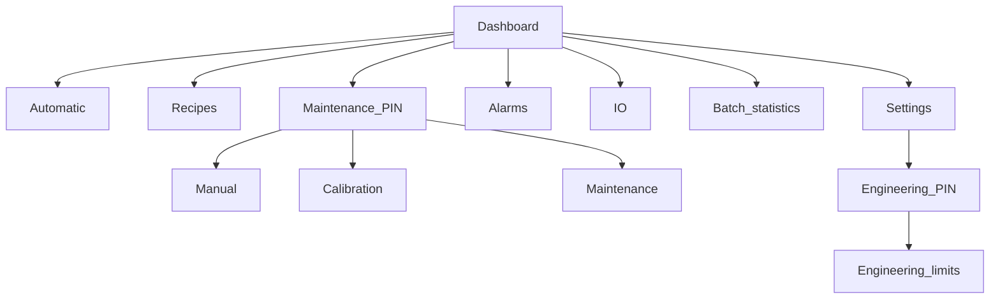

# Software Design

| Field | Value |
| --- | --- |
| Document | 05-Software-Design.md |
| Product | Piaya Dough Maker prototype |
| Status | Planning baseline. No source files are created by this document. |
| Date | 2026-10-26 |

This is the firmware design the later phases implement. Requirements are in [02-Technical-Requirements.md](02-Technical-Requirements.md). Wiring is in [04-Hardware-Design.md](04-Hardware-Design.md). Tasks and queues are in [03-System-Architecture.md](03-System-Architecture.md).

## 1. Execution rules

- Language is C. The HMI task is the only caller of LVGL.
- The machine task is the only owner of the state variable.
- The I/O task is the only caller of the PCF8575 bus.
- The diagnostics task is the only writer of NVS after boot has finished loading.
- Timers are deadlines checked every 10 ms. No state function delays for a stroke.
- Global transitions are evaluated before a state's own deadline.

Global transitions, in order:

1. Safety monitor unhealthy moves any state to `ESTOP`, requests the inactive output image, and records `ESTOP_ACTIVE` if it is not already recorded.
2. I2C failure, low air, or drive fault moves any state except `ESTOP` to `FAULT`, requests the inactive image, and records `I2C_IO_FAILURE`, `AIR_LOW`, or `DRIVE_FAULT`.
3. STOP, from a moving or waiting production state, moves to `STOPPING`. Production states are mix, every transfer state, confirm, every forming state, and door close.
4. A command that is illegal in the current state is dropped. Mode changes during a batch are in that category.

`UNCOMMISSIONED` is a standing banner in idle. It does not take the fault state.

## 2. Drivers

### 2.1 PCF8575

The driver keeps a 16-bit shadow. Bit 0 is logical P0. Bits 0–7 are the first I2C data byte. Bits 8–15 are the second data byte, which the datasheet calls P10–P17. See [04-Hardware-Design.md](04-Hardware-Design.md).

| Call | Behavior |
| --- | --- |
| `pcf8575_init` | Opens the existing board I2C bus, probes 7-bit address `0x20`, writes `0xFFFF`. A failed probe returns an error and does not pretend the outputs are off. |
| `pcf8575_write` | Writes the shadow. On timeout, returns an error and leaves the shadow unchanged so the caller can retry the same image. |
| `pcf8575_read` | Writes the current shadow, then reads two bytes. Input bits in the shadow must already be 1. |
| `pcf8575_recover` | Runs the ESP-IDF bus recovery, then probes `0x20` again and writes the inactive image. |

Host tests replace the bus with a fake that records writes and can fail on command. Tests cover power-on image `0xFFFF`, byte order of P8 in the second byte, a failed write that does not clear the caller's requested image, and recovery that ends with another `0xFFFF` write.

The driver does not know valve names.

### 2.2 Field I/O

Logical outputs are an enum: mixer run, conveyor run, door open, door close, plunger extend, plunger retract, cutter extend, cutter retract, flattener. Logical inputs match P9–P15.

`field_io_apply` builds the 16-bit image:

1. Start from inactive.
2. Set bits requested by the machine task.
3. If a forbidden pair is both set, clear both and return an exclusion error. Pairs are door open with door close, plunger extend with retract, and cutter extend with retract.
4. If the safety monitor, air, drive fault, or link health fails, force every output inactive.
5. Apply the engineering polarity mask. Default: active output writes 0.
6. Force input bit positions to 1.
7. Hand the image to the I/O task.

Debounce counters live here, one per input, using the stored debounce time. The machine task sees the debounced levels.

### 2.3 Board

`board` is copied from the Waveshare demo after phase 1 names the helper chip. It exposes display init, touch read, and backlight set. Brightness is a percentage stored in machine settings and passed to the demo's backlight function. If that function does not exist on the board revision in hand, the HMI hides the control. No third-party PWM limit is compiled in.

## 3. State transition table

Entry actions happen once. The output request is refreshed every poll. "Inactive" means no run bit and no solenoid bit. "Center" means both coils of that valve are off while other outputs stay as the state requests. Deadlines use the recipe snapshot unless noted.

Fault column means the additional local fault. Global rules in section 1 still apply.

### 3.1 Session states

| State | Entry | Actions | Timer | Exit | Timeout | Fault local to this state |
| --- | --- | --- | --- | --- | --- | --- |
| `BOOT` | Reset | Load config. Init board. Write `0xFFFF`. Start I/O. If an interrupted-batch flag is set, keep it for the dashboard and clear the resume meaning. | None | Safety monitor healthy goes to `IDLE`. Unhealthy goes to `ESTOP`. I2C failure goes to `FAULT`. | Not used | Corrupt store loads factory data, raises `NVS_CORRUPT`, clears commissioned, then continues to `IDLE` if the monitor is healthy. |
| `IDLE` | Boot, reset from stopped or fault, batch acknowledge, or maintenance exit | Inactive outputs. Show recipe, target, and banners. | None | Start with permissives and commissioned snapshot goes to `PRECHECK`. Close-door command goes to `DOOR_CLOSE`. Maintenance PIN goes to `MAINT`. | Not used | Start while uncommissioned or invalid raises the matching banner and stays here. |
| `PRECHECK` | Start accepted | Copy recipe and motion limits into the batch snapshot. Re-read permissives and the door switch. | One poll | Door closed, snapshot valid, and common permissives true goes to `MIX_RUN` and sets the interrupted-batch flag. Door open, uncommissioned, or an invalid snapshot returns to `IDLE` with the matching banner. | Not used | Door open here is a refused start, not `DOOR_OPEN_DURING_MIX`. Air, drive fault, I2C failure, and the safety monitor follow the global rules. |
| `STOPPED` | `STOPPING` finished its write | Inactive. | None | Firmware RESET goes to `IDLE`. | Not used | None beyond global rules. |
| `FAULT` | A process fault | Inactive. Record code and previous state. | None | Cause clear and firmware RESET goes to `IDLE`. Cause still present ignores RESET. | Not used | `ESTOP` still preempts. |
| `ESTOP` | Monitor unhealthy | Inactive. Record `ESTOP_ACTIVE`. | None | Monitor healthy and firmware RESET goes to `IDLE`. RESET while the monitor is still unhealthy is ignored. | Not used | Firmware cannot reset the safety relay. |
| `MAINT` | PIN accepted from `IDLE` | Inactive until a jog press. Each press is one logical output, edge-triggered, and is dropped on release. | While held, the output stays requested. No motion timer. | Exit command with all presses released and inactive image written goes to `IDLE`. | Not used | A second coil of an excluded pair is rejected. Mixer jog with the door open requires the on-screen guard acknowledgement for that entry into maintenance. |
| `DOOR_CLOSE` | Close command from `IDLE` or `BATCH_DONE` | Door close coil on. Other outputs off. | Door-close time plus margin | Door switch becomes true goes to the caller state with coils off. | `DOOR_CLOSE_TIMEOUT`, inactive image, `FAULT` | Door switch never true within the deadline. |

`BATCH_DONE` is listed with the forming states below. Close-door from `BATCH_DONE` returns to `BATCH_DONE` if the switch becomes true.

### 3.2 Mixing and transfer

| State | Entry | Actions | Timer | Exit | Timeout | Local fault |
| --- | --- | --- | --- | --- | --- | --- |
| `MIX_RUN` | Precheck passed | Mixer run on. Door close is not commanded. The door switch must read closed every poll. | Mix time | Deadline goes to `XFER_DOOR_PARTIAL` with mixer run removed. | The mix deadline is normal completion, not a fault. | Door switch clear raises `DOOR_OPEN_DURING_MIX` and `FAULT`. |
| `XFER_DOOR_PARTIAL` | Mix done | Door open coil on. | Partial-open time | Deadline goes to `XFER_DOOR_CENTER_1`. | Normal completion. Position is not confirmed. | Global only. |
| `XFER_DOOR_CENTER_1` | Partial timer done | Both door coils off. | Until the inactive door image is written | Success goes to `XFER_MIX_1`. | Write failure is `I2C_IO_FAILURE`. | Global only. |
| `XFER_MIX_1` | Door centered | Mixer run on. Door switch is not required. | Transfer mix 1 | Deadline goes to `XFER_PUSH_1` with mixer run removed. | Normal completion. | Global only. |
| `XFER_PUSH_1` | Mix 1 done | Plunger extend on. | Push 1 time | Deadline goes to `XFER_PLUNGER_CENTER_1`. | Normal completion. Stroke is not confirmed. | Global only. |
| `XFER_PLUNGER_CENTER_1` | Push 1 done | Both plunger coils off. | Until the write succeeds | Success goes to `XFER_RETRACT_1` if retract 1 is greater than 0, otherwise to `XFER_DOOR_FULL`. | Write failure is I2C fault. | Global only. |
| `XFER_RETRACT_1` | Retract 1 greater than 0 | Plunger retract on. | Retract 1 time | Deadline goes to a center write, then `XFER_DOOR_FULL`. | Normal completion. | Global only. |
| `XFER_DOOR_FULL` | Previous push path done | Door open coil on. | Full-open time | Deadline goes to `XFER_DOOR_CENTER_2`. | Normal completion. | Global only. |
| `XFER_DOOR_CENTER_2` | Full-open timer done | Both door coils off. | Until the write succeeds | Success goes to `XFER_MIX_2`. | I2C fault on failure. | Global only. |
| `XFER_MIX_2` | Door centered | Mixer run on. | Transfer mix 2 | Deadline goes to `XFER_PUSH_2` with mixer run removed. | Normal completion. | Global only. |
| `XFER_PUSH_2` | Mix 2 done | Plunger extend on. | Push 2 time | Deadline goes to `XFER_PLUNGER_CENTER_2`. | Normal completion. | Global only. |
| `XFER_PLUNGER_CENTER_2` | Push 2 done | Both plunger coils off. | Until the write succeeds | Success goes to `XFER_RETRACT_2` if retract 2 is greater than 0, otherwise to `XFER_CONFIRM`. | I2C fault on failure. | Global only. |
| `XFER_RETRACT_2` | Retract 2 greater than 0 | Plunger retract on. | Retract 2 time | Deadline centers the plunger, then `XFER_CONFIRM`. | Normal completion. | Global only. |
| `XFER_CONFIRM` | Transfer motions done | Inactive. | Waits for the operator | Barrel-ready command goes to `FORM_PLUNGE`. Stop goes to `STOPPING`. | No automatic timeout. There is no dough sensor. | Global only. |

**Open** items that can still change this table after a mechanical review: the meaning of partial open, whether retract 1 must be non-zero before the full-open step, and whether retract 2 must be non-zero before confirm. Until that review, a stored 0 skips the retract and the order above stays.

### 3.3 Forming and batch end

The cutter runs while the plunger is in the center command that followed the forming pulse. The forming retract does not run between the pulse and the cutter. If the forming-retract time is greater than 0, the plunger retracts after the piece is counted, before the next pulse or before batch done.

| State | Entry | Actions | Timer | Exit | Timeout | Local fault |
| --- | --- | --- | --- | --- | --- | --- |
| `FORM_PLUNGE` | Confirm, or another cycle | Plunger extend on. | Forming pulse | Deadline goes to `FORM_PLUNGE_CENTER`. | Normal completion. Mass is not confirmed. | Global only. |
| `FORM_PLUNGE_CENTER` | Pulse done | Both plunger coils off. | Until the write succeeds | Success goes to `FORM_CUT_EXTEND`. | I2C fault on failure. | Global only. |
| `FORM_CUT_EXTEND` | Plunger centered | Cutter extend on. | Cutter extend time | Deadline goes to `FORM_CUT_DWELL` if dwell is greater than 0, otherwise `FORM_CUT_RETRACT`. | Normal completion. Blade position is not confirmed. | Global only. |
| `FORM_CUT_DWELL` | Dwell greater than 0 | Cutter extend remains on. | Cutter dwell | Deadline goes to `FORM_CUT_RETRACT`. | Normal completion. | Global only. |
| `FORM_CUT_RETRACT` | Cut time done | Cutter extend off, cutter retract on. | Cutter retract time | Deadline turns the cutter coils off, then `FORM_CONVEY`. | Normal completion. | Global only. |
| `FORM_CONVEY` | Cutter command finished | Conveyor run on. | Conveyor time | Deadline removes conveyor run and goes to `FORM_FLAT_DOWN`. | Normal completion. Distance is not measured. | Global only. |
| `FORM_FLAT_DOWN` | Conveyor stopped | Flattener solenoid on. | Down time | Deadline goes to `FORM_FLAT_DWELL`. | Normal completion. Direction depends on the low-pressure plumbing check. | Global only. |
| `FORM_FLAT_DWELL` | Down timer done | Solenoid remains on. | Dwell time. A stored 0 completes on the next poll. | Deadline goes to `FORM_FLAT_UP`. | Normal completion. | Global only. |
| `FORM_FLAT_UP` | Dwell done | Flattener solenoid off. | Up time | Deadline goes to `FORM_COUNT`. | Normal completion. This timer is the cycle-complete point. | Global only. |
| `FORM_COUNT` | Up timer done | Inactive. Add 1 cycle. Add the nozzle count to pieces. Queue a progress checkpoint. | One poll | If pieces are still below the target, go to `FORM_RETRACT` when forming retract is greater than 0, otherwise `FORM_PLUNGE`. If the target is met, go to `FORM_RETRACT` or `BATCH_DONE` the same way. | Not a fault. | A checkpoint write failure raises `NVS_SAVE_FAIL` and `FAULT` after the count is kept in RAM. The count is not rolled back. |
| `FORM_RETRACT` | Count done and retract time greater than 0 | Plunger retract on. | Forming retract time | Deadline centers the plunger, then `FORM_PLUNGE` or `BATCH_DONE` from the decision already taken in `FORM_COUNT`. | Normal completion. | Global only. |
| `BATCH_DONE` | Target met and any end retract finished | Inactive. Store the batch record. Show completed and remaining. | Waits | Acknowledge goes to `IDLE` and clears the interrupted-batch flag. Close-door may run and return here. | No automatic next batch. | Global only. |
| `STOPPING` | STOP from a production state | Inactive image. Do not add a piece unless `FORM_COUNT` already ran. | Until the inactive write succeeds | Success goes to `STOPPED`. | I2C failure goes to `FAULT` as well as the stop. | None beyond that write. |

Remaining pieces on screen is target minus completed, floored at zero. A stop during `FORM_FLAT_UP` does not count. A stop during `FORM_COUNT` is too late to undo the increment if the add already happened.

## 4. Output interlock matrix

Rows are requests. "Auto" means only in the listed states. Maintenance may request the output only while `MAINT` is active, the matching button is held, and the common permissives pass. A maintenance mixer run with the door switch clear also needs the guard acknowledgement captured for that maintenance entry.

| Request | Automatic states | Blocked when |
| --- | --- | --- |
| Mixer run | `MIX_RUN` with door closed. `XFER_MIX_1` and `XFER_MIX_2` without the door switch. | Any failed common permissive, or door clear inside `MIX_RUN`. |
| Conveyor run | `FORM_CONVEY` | Failed common permissive. |
| Door open | `XFER_DOOR_PARTIAL`, `XFER_DOOR_FULL` | Door close also requested. Failed common permissive. |
| Door close | `DOOR_CLOSE` | Door open also requested. Failed common permissive. |
| Plunger extend | `XFER_PUSH_1`, `XFER_PUSH_2`, `FORM_PLUNGE` | Retract also requested. Failed common permissive. |
| Plunger retract | `XFER_RETRACT_1`, `XFER_RETRACT_2`, `FORM_RETRACT` | Extend also requested. Failed common permissive. |
| Cutter extend | `FORM_CUT_EXTEND`, `FORM_CUT_DWELL` | Retract also requested. Failed common permissive. |
| Cutter retract | `FORM_CUT_RETRACT` | Extend also requested. Failed common permissive. |
| Flattener | `FORM_FLAT_DOWN`, `FORM_FLAT_DWELL` | Failed common permissive. Off in `FORM_FLAT_UP` and everywhere else. |

Common permissives are safety monitor in the run state, air OK, drives healthy, and I/O link healthy. Hardware coil cross-interlocks remain in force when this table is wrong. There is no software output for the safety relay.

## 5. HMI

| Screen | Contents |
| --- | --- |
| Dashboard | State name, recipe name, commanded runs and coils, measured inputs, pieces completed and target, active alarm. Commanded and measured columns have those words in the headings. |
| Automatic | Snapshot summary, Start, Stop, barrel-ready when the state is `XFER_CONFIRM`, acknowledge when the state is `BATCH_DONE`. Start is disabled while uncommissioned or faulted. |
| Recipes | List of eight. Create, rename, duplicate, select, delete with confirmation, and a review page of every process field before start. |
| Settings | One category list: mix, door, plunger, cutter, conveyor, flattener, batch. Each row is the editor from the technical requirements. Apply and Cancel. |
| Manual | One button per logical output, held to jog. Banner that positions are not measured. Mixer jog shows the guard warning until accepted. |
| I/O | Last write, last read, decoded names, last I2C error. |
| Alarms | Active alarm and the 32-entry history, with recovery text. |
| Calibration | Pulse, sample count, total weight, computed average, hint, Confirm and Cancel. |
| Batch statistics | Counts, remaining, theoretical piece estimate and cycle estimate labeled estimate, rejected-piece adjustment. |
| Maintenance | Command counters labeled as commands, reminder thresholds, log level. |
| Engineering | Polarity masks, limits, commissioned switch, PIN change. Reached only through the engineering PIN. |

The keypad is a button matrix plus a display of the field name, unit, and limits. Destructive confirms are modal. Unsaved edits prompt before leaving the page.

Touch targets are sized for gloved use on a 1024 × 600 landscape panel. If phase 1 rotates the mounting, the same screens are rebuilt in that orientation before phase 8 is accepted.

## 6. NVS layout

| Namespace | Key | Payload |
| --- | --- | --- |
| `meta` | `schema` | Schema version integer |
| `meta` | `commissioned` | 0 or 1 |
| `meta` | `batch_active` | Interrupted flag and last completed counts |
| `recipes` | `slot0` … `slot7` | `recipe_blob_t` |
| `machine` | `cfg` | Debounce, margins, display options, brightness, log level, reminder thresholds |
| `calib` | `limits` | Forming-pulse minimum and maximum |
| `maint` | `counts` | Command counters |
| `alarms` | `ring` | 32 records and the next write index |

`recipe_blob_t` fields are the recipe table in [02-Technical-Requirements.md](02-Technical-Requirements.md), plus the schema version. Strings are fixed 24-byte buffers.

Factory data is compiled. Each required time is the minimum of its recommendation range. Optional retracts and dwells are 0. `commissioned` is false. Those numbers only make a valid blob. They are not process targets. Start stays refused until engineering replaces them from a trial and then sets the flag.

Validation rejects a blob whose version mismatches, whose name is empty, whose numbers fall outside the active limits, or whose nozzle count is outside 1–2. Save failure keeps the previous RAM copy and raises `NVS_SAVE_FAIL`.

The partition recommendation is 64 KB for NVS, recorded in the technical requirements. No output image is a key.

## 7. Calibration workflow

Implemented on the calibration screen and executed by the machine task as a maintenance sequence that reuses `FORM_PLUNGE` through `FORM_FLAT_UP` for the sample count, without adding those samples to the production batch target. Sample pieces are not written as a completed production batch.

1. Maintenance mode, recipe selected, pulse inside the engineering limits.
2. Operator starts the sample run. The machine produces the sample count and stops.
3. Operator weighs the pieces externally and enters count and total grams.
4. Average = total grams / count. Difference = average minus target grams.
5. Hint = current pulse plus or minus 10 percent of the current pulse, toward a smaller pulse when the average is high, then clamped to the engineering minimum and maximum.
6. Confirm writes the pulse into the recipe through the NVS queue. Cancel leaves the recipe unchanged.

Count 0 or total weight 0 is `SETTINGS_REJECTED`. The hint text states that the step is not a linear mass model.

Theoretical estimates on the batch screen use floor(15000 / target grams) and then floor of that result divided by the nozzle count. They are labeled estimate.

## 8. Alarms and recovery text

| Code | Message | Recovery text |
| --- | --- | --- |
| `ESTOP_ACTIVE` | Emergency stop is open. | Reset the safety relay with its own button. Then press firmware RESET. Then press START for a new batch. |
| `AIR_LOW` | Air pressure is low. | Restore pressure. Press firmware RESET. Check the machine before START. |
| `DOOR_OPEN_DURING_MIX` | Mixer door opened during mixing. | Close the door. Press firmware RESET. Start a new batch. |
| `DOOR_CLOSE_TIMEOUT` | Door did not report closed in time. | Inspect the door. The timer is not a position proof. Press firmware RESET after the switch reads closed. |
| `I2C_IO_FAILURE` | Field I/O link failed. | Outputs may still be latched. Remove field power if motion continues. Restore the link. RESET, then a new START. |
| `DRIVE_FAULT` | A drive reports a fault. | Reset the drive using its own manual. Firmware RESET does not reset the drive. |
| `CONFIG_INVALID` | The recipe snapshot is not valid. | Return to Settings and correct the named field. |
| `NVS_CORRUPT` | Stored settings were replaced with factory data. | Commission the machine again. The commissioned flag is clear. |
| `NVS_SAVE_FAIL` | The last save did not complete. | The previous saved values remain. Retry the save. |
| `SETTINGS_REJECTED` | That value is outside its limits. | Read the minimum and maximum on the row. |
| `UNCOMMISSIONED` | This machine has not been commissioned. | Engineering must save trial times and set commissioned. |

History records store the code, the state enum name, and the message. The ring drops the oldest of 32.

## 9. Logging

Log at information level: state entry, commands, recipe name on save, batch completion counts, and reset cause at boot. Log at error level: each alarm and each I2C error. Do not log the 10 ms poll. The maintenance log-level setting selects the ESP-IDF verbosity and does not filter the alarm ring.

## 10. Tests that belong to this design

Host tests, later implemented under `test/`, must fail before the production logic exists and pass after it:

- Byte order: logical P8 sets only the low bit of the second data byte.
- Inactive image is `0xFFFF` and is the boot write.
- Exclusion: requesting door open and door close yields neither and an error.
- Mix with the door switch clearing enters `FAULT` with `DOOR_OPEN_DURING_MIX` and mixer run off.
- Transfer order matches section 3.2, including a 0 ms retract skip.
- Forming order matches section 3.3. Pieces increase only in `FORM_COUNT`.
- STOP during `FORM_FLAT_UP` does not increase pieces.
- Reboot from a fake mid-batch flag enters `IDLE` and does not enter `FORM_PLUNGE`.
- Calibration hint moves 10 percent toward the target and does not write until confirm.
- A corrupt blob loads factory data and clears commissioned.

Hardware tests are in [06-Implementation-Plan.md](06-Implementation-Plan.md).
