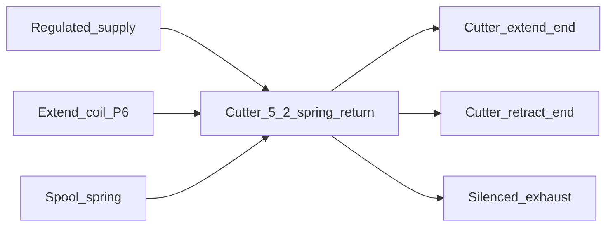

# Client-Drawing Alignment Implementation Plan

> **For agentic workers:** REQUIRED SUB-SKILL: Use superpowers:subagent-driven-development (recommended) or superpowers:executing-plans to implement this plan task-by-task. Steps use checkbox (`- [ ]`) syntax for tracking.

**Goal:** Put the client mechanical drawing beside the control documents, lock the engineering decisions the sheets do not mention, and remove the contradictions named in the alignment spec.

**Architecture:** Copy the client PDF into `docs/client/`. Write `docs/07-Client-Drawing-Alignment.md` as the only place for part names, transcribed geometry, mismatches, accepted decisions, and blanks. Edit `README.md` and `docs/01` through `docs/06` only where a sentence still contradicts that record.

**Tech Stack:** Markdown documents, a byte-copied PDF, PowerShell, and Python with PyMuPDF for page images. No firmware, no ESP-IDF tree, no test runner.

## Global Constraints

- Control behavior of record stays in `docs/01` through `docs/06`: Waveshare touch SKU 31726, recipes, timers, permissives, and the hardwired emergency stop.
- Client geometry is labeled **Client drawing**. It is never labeled **Verified**.
- A **Verified** figure still requires a manufacturer document already cited in `docs/04-Hardware-Design.md`.
- Do not invent air pressure, pneumatic bore, pneumatic stroke, valve flow, coil current, fuse rating, drive terminal names, or which axes fall.
- Do not copy a dough-barrel diameter into a pneumatic bore, stroke, or valve-flow field.
- Do not rename the control sequence to gate, piston, shutter, or press.
- Do not add a hopper state, a second flattener output, or a second cutter output.
- Do not claim ISO 13849, IEC 62061, or IEC 60204 compliance.
- Do not create firmware files.
- Implementation commits go on branch `docs/client-drawing-alignment`, not on `main`.
- Source PDF: `C:\Users\janre\Downloads\design-1.pdf`.
- Repository copy: `docs/client/piaya-dough-making-machine.pdf`.
- Spec: `docs/superpowers/specs/2026-10-26-client-drawing-alignment-design.md`.

---

### Task 1: Branch, PDF copy, and alignment document

**Files:**
- Create: `docs/client/piaya-dough-making-machine.pdf`
- Create: `docs/07-Client-Drawing-Alignment.md`
- Test: hash comparison of the two PDFs

**Interfaces:**
- Consumes: the client PDF at `C:\Users\janre\Downloads\design-1.pdf` and decisions D1–D14, mismatches M1–M8, and the blank list in the spec.
- Produces: document 07 sections `Part-name map`, `Mismatches`, `Decisions accepted here`, and `Facts that stay blank`. Later tasks cite those headings and do not restate a decision as still open.

- [ ] **Step 1: Create the branch**

Run:

```powershell
git status -sb
git checkout -b docs/client-drawing-alignment
```

Expected: status shows `main` tracking `origin/main` before the checkout. After it, the branch name is `docs/client-drawing-alignment`. If `git status` shows a branch other than `main`, stop and ask. Do not commit on `main`.

- [ ] **Step 2: Copy the PDF and compare hashes**

Run:

```powershell
New-Item -ItemType Directory -Force -Path "docs/client" | Out-Null
Copy-Item -LiteralPath "C:\Users\janre\Downloads\design-1.pdf" -Destination "docs/client/piaya-dough-making-machine.pdf"
$src = (Get-FileHash -LiteralPath "C:\Users\janre\Downloads\design-1.pdf" -Algorithm SHA256).Hash
$dst = (Get-FileHash -LiteralPath "docs/client/piaya-dough-making-machine.pdf" -Algorithm SHA256).Hash
if ($src -ne $dst) { throw "PDF hash mismatch" }
"MATCH $src"
```

Expected: one line beginning with `MATCH` and a 64-character hex hash. A thrown mismatch stops the task.

- [ ] **Step 3: Write document 07**

Create `docs/07-Client-Drawing-Alignment.md` with this body. The geometry section is a header only. Task 2 fills the rows.

```markdown
# Client Drawing Alignment

| Field | Value |
| --- | --- |
| Document | 07-Client-Drawing-Alignment.md |
| Product | Piaya Dough Maker prototype |
| Status | Alignment record. Control behavior remains in documents 01 through 06. |
| Date | 2026-10-26 |
| Source | [docs/client/piaya-dough-making-machine.pdf](client/piaya-dough-making-machine.pdf) |

This document records the client mechanical drawing. It does not replace the control sequence. A dimension here is **Client drawing**: transcribed from the PDF, not measured on a built machine, and not a manufacturer datasheet. **Verified** is not used in this document.

## 1. Part-name map

The control documents keep the left-hand names. The right-hand names are the labels this record expects on the sheets. Task 2 of the alignment plan corrects a right-hand cell when the printed label differs, and adds a mismatch row for that difference.

| Control name | Client part |
| --- | --- |
| Mixer motor | Belt motor on the sigma-blade mixer |
| Mixer door | Gate |
| Forming barrel | Cylinder with an entry, an exit, and a shaft entrance |
| Plunger | Pneumatic piston |
| Cutter | Shutter cutter |
| Flattener | Pneumatic press |
| Conveyor | Teflon-coated fabric conveyor belt |
| Operator interface hardware | Control-panel casing, LCD, and push buttons |
| Frame | Base |
| Ingredient inlet | Hopper |

## 2. Geometry

Columns are sheet number or `model view`, sheet-content title, view name, callout text, and value. A value that cannot be read is the word `unreadable`. Dough-barrel diameters stay in this table. They are not pneumatic bores.

| Sheet | Title | View | Callout | Value |
| --- | --- | --- | --- | --- |
| | | | | |

## 3. Mismatches

Resolution for every row is `Control sequence unchanged`. The client column is corrected to the printed sheet when transcription disagrees with it. Rows M1 through M8 stay.

| Id | Sheet | What the client sheets show | What the control design keeps |
| --- | --- | --- | --- |
| M1 | Control panel | The control-panel sheet's LCD and push buttons, as labeled on that sheet | Waveshare ESP32-S3-Touch-LCD-7B, 1024 × 600, plus physical START, STOP, firmware RESET, and a separate hardwired emergency-stop reset |
| M2 | Mixing components | A sigma-blade mixer, a belt motor, and a gate | A mixer-drive run command and a timed pneumatic door with a closed switch, a partial-open command, and a full-open command |
| M3 | Pneumatic piston and cylinder | A horizontal pneumatic piston and a separate dough barrel | Timed plunger extend, center, and optional retract into the forming barrel |
| M4 | Shutter cutter | A shutter cutter | Timed cutter extend, optional dwell, and retract. The control valve is spring-return to retract. The sheet does not show that valve |
| M5 | Pneumatic press | A pneumatic press with pressing plates | One flattener solenoid: down, dwell, up |
| M6 | Expected output | A conveyor belt | A timed conveyor-drive run. The sheets do not name a variable-frequency drive |
| M7 | Hopper | A hopper | No hopper actuator and no hopper state |
| M8 | All titled sheets | Whatever the titled sheets show about guards and a partial-open stop. Absence is recorded as absence | Fixed guards before any transfer mix with the door open, and a mechanical stop before a dough trial uses the partial-open command |

## 4. Decisions accepted here

The client sheets do not show these items. They are accepted for the control design.

| Id | Accepted reading |
| --- | --- |
| D1 | Documents 01 through 06 remain the control design of record. This document is the alignment record. |
| D2 | The controller target remains touch SKU 31726. Phase 1 still confirms the board in hand. |
| D3 | P15 is the drive-fault input. Both drive fault contacts are in series, closed when both drives are healthy, and the expander pin is low in that state. |
| D4 | PCF8575 outputs are active low. The device is powered at 3.3 V. The 7-bit address is `0x20`. Input sense is the named-condition table in the technical and software documents. |
| D5 | The GPIO6 output-enable watchdog is mandatory equipment protection for this prototype. Its part number and timeout stay blank. |
| D6 | The cutter valve used by the control design is a 5/2 single-solenoid spring-return valve. With air present, the spring-selected port is retract. P7 is unused and is written inactive. M4 records that the sheet shows a shutter and does not show this valve. |
| D7 | Barrel ready is an operator confirmation. No barrel sensor is added. |
| D8 | The safety relay keeps its own reset. Firmware RESET is a separate control. Neither one performs the other. |
| D9 | The prototype stays English only, with eight recipes, no live process edits during a batch, and no speed command to a drive. |
| D10 | Air preparation is a lockable shutoff, filter, regulator, gauge, and lockable exhaust, with no lubricator. Whether the compressor is oil-free stays blank. Operating pressure stays blank. |
| D11 | Fixed guards are required before any dough trial in which the mixer runs with the door switch clear. |
| D12 | A dough trial that uses the partial-open command requires a mechanical stop. The opening distance stays blank unless a legible callout gives it. |
| D13 | Operation is forbidden on any axis a mechanical review says can fall, until a restraint or a pilot-operated check is fitted. This record does not assert which axes fall. |
| D14 | Firmware remains a separate approval. This revision creates no firmware. |

## 5. Facts that stay blank

No planning number is written for any of these.

- Variable-frequency-drive manufacturer, model, manual, terminal names, sink or source, and fault-contact rating
- Pneumatic bore, stroke, load, and required stroke time for the door, plunger, cutter, and flattener
- Operating air pressure, valve flow, port size, coil current, supply current, and fuse rating
- PCF8575 module schematic, onboard helper-chip identity, backlight register, and GPIO6 header voltage
- Watchdog part number and timeout
- Oil-free compressor status
- Which axes fall when air or electrical power is lost
- Enclosure, washdown, and ambient temperature
- Any client callout marked `unreadable`

## 6. Shutter openings

This sentence is replaced by Task 2 after the shutter sheet is read: `Shutter opening count: not yet read.`

## 7. Related documents

| Document | Contents |
| --- | --- |
| [01-Product-Requirements.md](01-Product-Requirements.md) | Process, operator capabilities, timer-only limits, and scope |
| [02-Technical-Requirements.md](02-Technical-Requirements.md) | Settings, permissives, HMI, storage, and access rules |
| [03-System-Architecture.md](03-System-Architecture.md) | Controllers, tasks, data, and interlocks |
| [04-Hardware-Design.md](04-Hardware-Design.md) | Verified parts, wiring, pneumatics, and bill of materials |
| [05-Software-Design.md](05-Software-Design.md) | State table, screens, drivers, and alarms |
| [06-Implementation-Plan.md](06-Implementation-Plan.md) | Phases, tests, commissioning, and remaining blanks |
```

- [ ] **Step 4: Check the static record**

Run:

```powershell
rg -n "TBD|TODO|Verified" docs/07-Client-Drawing-Alignment.md
rg -n "^\| D1[0-4]? \|" docs/07-Client-Drawing-Alignment.md
rg -n "^\| M[1-8] \|" docs/07-Client-Drawing-Alignment.md
```

Expected: the first search may print the sentence that says **Verified** is not used in this document. It must not print a geometry row or a part name labeled **Verified**. `TBD` and `TODO` print nothing. The second search prints D1 through D14. The third prints M1 through M8.

- [ ] **Step 5: Commit**

```powershell
git add -- "docs/client/piaya-dough-making-machine.pdf" "docs/07-Client-Drawing-Alignment.md"
git commit -m "Add the client drawing and the alignment record beside the control design."
```

---

### Task 2: Transcribe the sheets

**Files:**
- Modify: `docs/07-Client-Drawing-Alignment.md` section `## 2. Geometry`, the part-name map, mismatch client columns, and section `## 6. Shutter openings`
- Test: page images under `$env:TEMP\piaya-design-read`

**Interfaces:**
- Consumes: `docs/client/piaya-dough-making-machine.pdf` and the empty geometry table from Task 1.
- Produces: one geometry row per legible callout, `unreadable` for the rest, a corrected part-name map, corrected M1–M8 client cells, and one of these two exact sentences in section 6: `Shutter opening count: 2. Document 02 may label nozzle-count default 2 as Client drawing.` or `Shutter opening count: unreadable. Document 02 keeps nozzle-count default 2 as Assumption.`

- [ ] **Step 1: Render every page**

Run:

```powershell
python -c "import pymupdf, os; doc = pymupdf.open(r'docs/client/piaya-dough-making-machine.pdf'); out = os.path.join(os.environ['TEMP'], 'piaya-design-read'); os.makedirs(out, exist_ok=True); print('pages', doc.page_count); [page.get_pixmap(matrix=pymupdf.Matrix(2, 2)).save(os.path.join(out, f'page-{i+1:02d}.png')) for i, page in enumerate(doc)]; print(out)"
```

Expected: `pages 14` and a directory path. If `pymupdf` is missing, run `python -m pip install pymupdf` and run the render again. Do not install any other package.

- [ ] **Step 2: Read each PNG and fill the geometry table**

Open `page-01.png` through `page-14.png` from the printed path. For each page, record the title-block sheet number and sheet-content title when a title block is printed. A page with no title block is `model view` and gets no invented sheet number.

Append one table row for every dimension, diameter, radius, angle, and leader label. Copy the callout text as printed. Use this row shape:

```markdown
| 4 | CYLINDER | TOP VIEW | 635 mm | 635 mm |
```

The example values above are a shape, not a measurement. Replace them with the print. When a glyph cannot be read, set Value to `unreadable` and still record the sheet and view. Do not reuse a number from a chat summary or from memory of an earlier look.

Keep dough-barrel rows and pneumatic-actuator rows on their own sheet titles. Do not add those diameters to `docs/04-Hardware-Design.md`.

- [ ] **Step 3: Correct the map and the mismatch client columns**

If a printed label differs from the part-name map, replace that cell with the printed words and add a new mismatch row `M9`, `M10`, and so on. Do not delete M1–M8.

Rewrite each M1–M8 client cell so it states what that sheet actually shows. Keep the control column and the resolution `Control sequence unchanged`.

On the shutter-cutter sheet, count labeled openings. Replace the section 6 sentence with exactly one of these:

```markdown
Shutter opening count: 2. Document 02 may label nozzle-count default 2 as Client drawing.
```

```markdown
Shutter opening count: unreadable. Document 02 keeps nozzle-count default 2 as Assumption.
```

If the count is legible and is not 2, write `Shutter opening count: N.` with that integer, and add a mismatch row whose control column still says the recipe default remains 2 until a later approval changes it.

For M8, write either the guard and stop callouts that were found, or `No guard and no partial-open stop are drawn on the titled sheets.`

If a second press cylinder is drawn, add a mismatch row. Do not add a second flattener output anywhere.

- [ ] **Step 4: Check the transcription**

Run:

```powershell
rg -n "TBD|TODO|not yet read" docs/07-Client-Drawing-Alignment.md
rg -n "\*\*Verified\*\*" docs/07-Client-Drawing-Alignment.md
rg -c "^\| " docs/07-Client-Drawing-Alignment.md
```

Expected: the first search prints nothing. The second search may print only the sentence that says **Verified** is not used in this document. No geometry value or part name is labeled **Verified**. The geometry table has more rows than the header. Every titled sheet named in the title blocks appears in the Sheet or Title column. Model-view pages appear as `model view`.

- [ ] **Step 5: Commit**

```powershell
git add -- "docs/07-Client-Drawing-Alignment.md"
git commit -m "Transcribe the client sheets into the alignment record."
```

---

### Task 3: README and product requirements pointers

**Files:**
- Modify: `README.md`
- Modify: `docs/01-Product-Requirements.md`
- Test: `rg` for document 07 and the removed detented-cutter wording

**Interfaces:**
- Consumes: document 07 headings from Task 1 and D6, D12.
- Produces: a README row for document 07, a status paragraph that names the remaining blanks, and a product label **Client drawing**.

- [ ] **Step 1: Update the README document table, pneumatics bullet, and status**

In `README.md`, add this row after the implementation-plan row:

```markdown
| [docs/07-Client-Drawing-Alignment.md](docs/07-Client-Drawing-Alignment.md) | Client part names, transcribed geometry, mismatches, and accepted decisions |
```

Replace the pneumatics bullet with:

```markdown
- Pneumatics: 5/3 closed-center valves for the door and plunger, a 5/2 spring-return valve for the cutter with the spring port plumbed to retract, and a 5/2 spring-return valve for the flattener. Valve size is not selected yet. P7 is unused.
```

Replace the status section with:

```markdown
## Status

Planning documents are in `docs/`. Client geometry and the mismatches with this control design are in [docs/07-Client-Drawing-Alignment.md](docs/07-Client-Drawing-Alignment.md). Drive manuals, pneumatic bore and stroke, coil current, air pressure, valve flow, and the helper-chip identity stay blank. The cutter valve in this control design is spring-return to retract. P15 is the drive-fault input. The GPIO6 watchdog is mandatory equipment protection, with its part number and timeout still blank.
```

- [ ] **Step 2: Update the product label legend, the cutter limit, the partial-open limit, and the related-document table**

In `docs/01-Product-Requirements.md`, add this bullet after the **Open** bullet:

```markdown
- **Client drawing** — transcribed from [07-Client-Drawing-Alignment.md](07-Client-Drawing-Alignment.md). Not a measurement of the built machine.
```

Replace the cutter bullet in section 5 with:

```markdown
- The cutter valve is a 5/2 single-solenoid spring-return. With air present, dropping the coil returns the spool toward retract. Loss of air does not prove the blade moved. There is no cutter sensor, so an incomplete cut is not detected. The client sheet shows a shutter and does not show this valve. See [07-Client-Drawing-Alignment.md](07-Client-Drawing-Alignment.md).
```

Replace the partial-open bullet's open sentence with:

```markdown
- The partial-open door position is stable only if a mechanical stop exists and the open timer is long enough to reach it. The piston can still creep away from that stop. A dough trial that uses this command requires that stop. The opening distance stays **Open** unless the alignment record quotes a legible callout.
```

Add this row to the related-document table:

```markdown
| [07-Client-Drawing-Alignment.md](07-Client-Drawing-Alignment.md) | Client part names, geometry, mismatches, and accepted decisions |
```

Leave the existing sentence that the mixer may run with the door switch clear only inside the transfer steps.

- [ ] **Step 3: Check the pointers**

Run:

```powershell
rg -n "07-Client-Drawing-Alignment" README.md docs/01-Product-Requirements.md
rg -n "detented" README.md docs/01-Product-Requirements.md
```

Expected: both files link document 07. The second search prints nothing.

- [ ] **Step 4: Commit**

```powershell
git add -- README.md docs/01-Product-Requirements.md
git commit -m "Point the product record at the client drawing and the accepted cutter valve."
```

---

### Task 4: Technical requirements

**Files:**
- Modify: `docs/02-Technical-Requirements.md`
- Test: `rg` for the new alarm, the checkpoint sentence, and Engineering in the screen list

**Interfaces:**
- Consumes: document 07 section 6 shutter sentence from Task 2. Alarm code `OUTPUT_EXCLUSION`. Named-condition table from spec section 8.6.
- Produces: the screen list including Engineering, the calibration paragraph shared with document 05, the required piece-count checkpoint, and the narrowed input polarity mask.

- [ ] **Step 1: Replace the engineering polarity bullets**

Replace the two polarity bullets in section 3.3 with:

```markdown
- Output polarity mask. Default is active low on every output, matching the PCF8575 power-on high.
- Input polarity mask for START and firmware RESET only. Factory value is active low, matching the named-condition table in section 4. Door closed, safety-relay monitor, air pressure, STOP, and drive fault are compiled from that table and are not settings.
```

Add this sentence to the compiled-settings paragraph, after the existing sentence about the reboot rule:

```markdown
The named conditions for the door, the safety monitor, air, STOP, and the drive-fault chain are compiled with those rules.
```

- [ ] **Step 2: Add the named-condition table and the engineering screen**

In section 4, after the bullet list and before section 5, insert:

```markdown
Named condition true when the pin is low:

| Input | Named condition |
| --- | --- |
| Door closed | Door is closed |
| Safety-relay monitor | Relay is in the run state |
| Air pressure | Pressure is OK |
| START | Button is pressed |
| STOP | Button is released and the wire is intact. Stop is requested when this condition is false |
| Firmware RESET | Button is pressed |
| Drive fault | Both drives report healthy. A drive fault is present when this condition is false |
```

Replace the screen-list sentence with:

```markdown
Screens: Dashboard, Automatic, Recipes, Settings, Manual, I/O, Alarms, Calibration, Batch statistics, Maintenance, and Engineering. Engineering is reached only through the engineering PIN.
```

- [ ] **Step 3: Describe the calibration run and the required checkpoint**

After the numbered calibration steps, add:

```markdown
A calibration run is entered from maintenance and carries a sample counter. Completing the flattener-up timer increments that counter and returns to the plunge state until the sample count is met, then returns to maintenance with outputs inactive. The run does not enter the production count state, does not change the production piece count, does not write the production checkpoint, and does not set the interrupted-batch flag.
```

Replace the checkpoint sentence with:

```markdown
On every successful production piece-count update the diagnostics task writes the completed counts and the interrupted-batch flag. A failed write raises `NVS_SAVE_FAIL`, enters the fault state, and keeps the count in RAM. That checkpoint is the only mid-batch NVS write. It is not an output image and it is not a resume token.
```

- [ ] **Step 4: Add the alarm, the trace row, and the nozzle note**

Add this row to the alarm table after `SETTINGS_REJECTED`:

```markdown
| `OUTPUT_EXCLUSION` | An automatic request set both coils of a pair. Outputs were forced inactive |
```

Add this row to the requirements trace:

```markdown
| Client drawing alignment | [07-Client-Drawing-Alignment.md](07-Client-Drawing-Alignment.md) |
```

Read `docs/07-Client-Drawing-Alignment.md` section 6. If it says the shutter opening count is 2, replace the nozzle-count notes cell with:

```markdown
Default 2 matches two openings on the client shutter-cutter sheet. **Client drawing.**
```

If section 6 says `unreadable`, leave `Default 2 is **Assumption**` in place. If section 6 gives some other integer, leave the Assumption note and do not change the default.

- [ ] **Step 5: Check the technical document**

Run:

```powershell
rg -n "OUTPUT_EXCLUSION|Engineering is reached only|sample counter|diagnostics task writes" docs/02-Technical-Requirements.md
rg -n "firmware may store" docs/02-Technical-Requirements.md
```

Expected: the first search prints the alarm, the screen sentence, the calibration paragraph, and the checkpoint sentence. The second search prints nothing.

- [ ] **Step 6: Commit**

```powershell
git add -- docs/02-Technical-Requirements.md
git commit -m "Make the technical rules match the accepted input sense, calibration run, and checkpoint."
```

---

### Task 5: System architecture

**Files:**
- Modify: `docs/03-System-Architecture.md`
- Test: `rg` for `OUTPUT_EXCLUSION` and `SETTINGS_REJECTED`

**Interfaces:**
- Consumes: `OUTPUT_EXCLUSION` from Task 4. Document 07 as the home of client geometry.
- Produces: command-validation wording that drops illegal commands without that alarm, and an exclusion step that enters fault only for an automatic pair request.

- [ ] **Step 1: Replace the command-validation sentence**

Replace:

```markdown
Command messages are plain C structs: start, stop, reset, acknowledge batch, close door, jog press, jog release, save recipe, select recipe, calibration confirm. The machine task validates them against the current state. Invalid commands are ignored and, where [02-Technical-Requirements.md](02-Technical-Requirements.md) requires it, raise `SETTINGS_REJECTED`.
```

with:

```markdown
Command messages are plain C structs: start, stop, reset, acknowledge batch, close door, jog press, jog release, save recipe, select recipe, calibration confirm. The machine task validates them against the current state. An illegal command for the current state is dropped and raises no alarm. A full HMI command queue rejects the new command on the screen and raises no alarm. An out-of-range edit raises `SETTINGS_REJECTED` and keeps the previous saved value.
```

- [ ] **Step 2: Replace the exclusion step and point geometry at document 07**

Replace step 2 of output arbitration with:

```markdown
2. `field_io` clears any opposing pair that is both true. An automatic request that set both ends records `OUTPUT_EXCLUSION` and the machine enters fault. A maintenance jog never sets both ends; the second press is rejected, the held coil stays, and no alarm is raised.
```

Replace the unresolved-items paragraph with:

```markdown
Phase 1 still has to identify the onboard helper chip before `board` can be frozen. The VFD terminal names are unresolved before the dry-contact wiring can be built. Cylinder data is unresolved before valves are sized. Those gaps are listed in [06-Implementation-Plan.md](06-Implementation-Plan.md) and are not filled by assumptions in this document. Client part names and transcribed geometry live in [07-Client-Drawing-Alignment.md](07-Client-Drawing-Alignment.md).
```

- [ ] **Step 3: Check the architecture document**

Run:

```powershell
rg -n "OUTPUT_EXCLUSION|07-Client-Drawing-Alignment" docs/03-System-Architecture.md
rg -n "where \[02-Technical-Requirements" docs/03-System-Architecture.md
```

Expected: the first search prints the exclusion step and the unresolved-items paragraph. The second search prints nothing.

- [ ] **Step 4: Commit**

```powershell
git add -- docs/03-System-Architecture.md
git commit -m "Separate rejected edits from illegal commands and name the exclusion fault."
```

---

### Task 6: Hardware design

**Files:**
- Modify: `docs/04-Hardware-Design.md`
- Test: `rg` for the spring-return cutter and the absent approval sentences

**Interfaces:**
- Consumes: D3, D5, and D6 from document 07. The named-condition table from Task 4.
- Produces: P7 unused, P15 accepted, GPIO6 watchdog accepted with part number and timeout still blank, and cutter text that matches spring-return.

- [ ] **Step 1: Add the label and retarget P7 and P15**

Add this bullet to the label list after **Open**:

```markdown
- **Client drawing** — transcribed in [07-Client-Drawing-Alignment.md](07-Client-Drawing-Alignment.md). A barrel diameter from that record is not a pneumatic bore, stroke, or valve flow.
```

Replace the P7 row's function and active-level cells with `Unused` and `Written inactive`.

Replace the two paragraphs under the I/O map that call P15 and the cutter an approval item with:

```markdown
P15 is accepted. Both drive fault contacts are in series, closed when both drives are healthy, and this pin is low in that state.

P7 is unused and is written inactive. The cutter valve is the spring-return valve in section 9.4.
```

- [ ] **Step 2: Accept the watchdog and replace the cutter section**

Replace the GPIO6 watchdog paragraph's opening label with:

```markdown
**GPIO6 watchdog, accepted equipment protection for this prototype.**
```

Leave the rest of that paragraph, including the blank part number and timeout.

Replace section 9.4, including its diagram, with:

```markdown
### 9.4 Cutter

**Current design:** 5/2 single-solenoid, spring return. P6 energizes the solenoid. With air present, the spring-selected port is retract, so coil off drives the spool toward retract. P7 is unused and is written inactive. Loss of air does not prove the blade moved. The client sheet shows a shutter and does not show this valve. See [07-Client-Drawing-Alignment.md](07-Client-Drawing-Alignment.md).



The detented 5/2 double-solenoid is the rejected alternative. There is no cutter sensor. A jam or a short stroke is not detected.
```

- [ ] **Step 3: Update the failure row and the bill-of-materials row**

Replace the stop-during-motion prototype-limit and stronger-hardware cells with:

```markdown
With air present, the cutter spool returns toward retract when the coil drops. Loss of air does not prove the blade moved.
```

and:

```markdown
A cutter sensor. Not in this prototype.
```

Replace the cutter-valve bill-of-materials row with:

```markdown
| Cutter valve | 5/2 single-solenoid spring-return, 24 V DC coil, spring port plumbed to retract | Flow **Open** | [07-Client-Drawing-Alignment.md](07-Client-Drawing-Alignment.md) records that the sheet shows a shutter | Detented 5/2 double-solenoid, rejected |
```

In section 2's open list, leave bore, stroke, pressure, coil current, and drive manuals in place. Do not add a number.

- [ ] **Step 4: Check the hardware document**

Run:

```powershell
rg -n "awaiting approval|if the detented valve is kept|unless explicitly rejected" docs/04-Hardware-Design.md
rg -n "Cutter_5_2_spring_return|P15 is accepted" docs/04-Hardware-Design.md
```

Expected: the first search prints nothing. The second prints the new diagram node and the P15 sentence.

- [ ] **Step 5: Commit**

```powershell
git add -- docs/04-Hardware-Design.md
git commit -m "Accept the spring-return cutter, the drive-fault input, and the watchdog."
```

---

### Task 7: Software design

**Files:**
- Modify: `docs/05-Software-Design.md`
- Test: `rg` for the removed guard acknowledgement and the new host tests

**Interfaces:**
- Consumes: the named-condition table and calibration paragraph from Task 4, `OUTPUT_EXCLUSION`, and D6 (P7 unused).
- Produces: maintenance mixer jog blocked when the door switch is clear, calibration bypass of `FORM_COUNT`, cutter retract as coil-off, door-close timeout behavior from `BATCH_DONE`, and the host tests in section 10.

- [ ] **Step 1: Narrow field I/O and the engineering screen**

Replace the logical-output sentence and exclusion step 3 with:

```markdown
Logical outputs are an enum: mixer run, conveyor run, door open, door close, plunger extend, plunger retract, cutter extend, flattener. There is no cutter-retract coil. Logical inputs match P9–P15.
```

```markdown
3. If a forbidden pair is both set, clear both and return an exclusion error. Pairs are door open with door close, and plunger extend with retract. An automatic request that hits this rule causes `OUTPUT_EXCLUSION` and `FAULT`. A maintenance second press is rejected without an alarm.
```

Replace the output-polarity step so it reads:

```markdown
5. Apply the engineering output polarity mask, and the input polarity mask only for START and firmware RESET. Default: an active output writes 0. Door, safety monitor, air, STOP, and drive fault use the named-condition table below and are not masked by a setting.
```

Insert this table after the field-I/O steps:

```markdown
Named condition true when the pin is low:

| Input | Named condition |
| --- | --- |
| Door closed | Door is closed |
| Safety-relay monitor | Relay is in the run state |
| Air pressure | Pressure is OK |
| START | Button is pressed |
| STOP | Button is released and the wire is intact. Stop is requested when this condition is false |
| Firmware RESET | Button is pressed |
| Drive fault | Both drives report healthy. A drive fault is present when this condition is false |
```

Replace the Engineering screen cell with:

```markdown
Output polarity mask, START and firmware RESET input polarity, limits, commissioned switch, PIN change. Door, air, safety monitor, STOP, and drive fault are compiled. Reached only through the engineering PIN.
```

- [ ] **Step 2: Fix maintenance, cutter retract, calibration exit, and door-close timeout**

Replace the `MAINT` local-fault cell with:

```markdown
A second coil of an excluded pair is rejected. Mixer jog while the door switch is clear is rejected and the mixer run bit stays off.
```

Replace the interlock introduction sentence about the guard acknowledgement with:

```markdown
A maintenance mixer run also requires the door-closed switch on every poll.
```

Replace the mixer-run blocked-when cell with:

```markdown
Any failed common permissive, door clear inside `MIX_RUN`, or door clear during a maintenance jog.
```

Replace the `FORM_CUT_RETRACT` actions cell with:

```markdown
Cutter extend off. No retract coil.
```

Replace the cutter-retract matrix row with:

```markdown
| Cutter extend off | `FORM_CUT_RETRACT` | Failed common permissive. P7 stays inactive. |
```

Under the forming table, add:

```markdown
When a calibration run is active, `FORM_FLAT_UP` does not enter `FORM_COUNT`. Its deadline increments the sample counter and returns to `FORM_PLUNGE` until the sample count is met, then returns to `MAINT` with outputs inactive.
```

After the sentence that close-door from `BATCH_DONE` returns to `BATCH_DONE`, add:

```markdown
A `DOOR_CLOSE_TIMEOUT` from `BATCH_DONE` enters `FAULT` and leaves the stored batch record in place. Firmware RESET then goes to `IDLE`. The finished batch is not resumed and its record is not deleted.
```

- [ ] **Step 3: Replace the calibration workflow and add the alarm and tests**

Replace the calibration workflow's opening paragraph and step 2 with:

```markdown
Implemented on the calibration screen and executed by the machine task as a maintenance sequence. The run uses `FORM_PLUNGE` through `FORM_FLAT_UP` for the sample count. It does not enter `FORM_COUNT`. Sample pieces are not written as a completed production batch, and the interrupted-batch flag is not set.
```

```markdown
2. Operator starts the sample run. Each flattener-up completion increments the sample counter only. The machine stops in maintenance when the sample count is met.
```

Add this alarm row after `SETTINGS_REJECTED`:

```markdown
| `OUTPUT_EXCLUSION` | Both coils of a pair were requested in automatic mode. | The outputs were forced off. Press firmware RESET. Start a new batch only after the request that set both coils is corrected. |
```

Add these host-test bullets before the hardware-tests sentence:

```markdown
- A maintenance mixer request with the door switch clear leaves the mixer run bit off.
- A calibration run of the configured sample count leaves the production piece count and the interrupted-batch flag unchanged.
- A STOP pin that is not low is a stop request.
- An automatic request for both door coils enters `FAULT` with `OUTPUT_EXCLUSION` and writes the inactive image.
- A safety-monitor loss from a forming state enters `ESTOP`.
```

Keep the existing bullet that pieces increase only in `FORM_COUNT`.

- [ ] **Step 4: Check the software document**

Run:

```powershell
rg -n "guard acknowledgement|cutter retract" docs/05-Software-Design.md
rg -n "OUTPUT_EXCLUSION|sample counter|STOP pin that is not low" docs/05-Software-Design.md
```

Expected: the first search prints nothing. The second prints the alarm, the calibration path, and the new test bullet.

- [ ] **Step 5: Commit**

```powershell
git add -- docs/05-Software-Design.md
git commit -m "Align the state table with door-closed jog, calibration counts, and the spring-return cutter."
```

---

### Task 8: Implementation plan decisions

**Files:**
- Modify: `docs/06-Implementation-Plan.md`
- Test: `rg` for the split headings and the phase 6 and phase 12 lines

**Interfaces:**
- Consumes: D1–D14 and the blank list from document 07. The host tests added in Task 7.
- Produces: section 5 split into accepted decisions and facts still blank. Phase 6 and phase 12 name the new cases.

- [ ] **Step 1: Replace section 5**

Replace the whole `## 5. Decisions still required` section, through the end of its numbered list and before `## 6. Risks that span phases`, with:

```markdown
## 5. Decisions accepted in the alignment revision

These readings are accepted. The client sheets do not show them. Detail is in [07-Client-Drawing-Alignment.md](07-Client-Drawing-Alignment.md).

1. Documents 01 through 06 remain the control design of record. Document 07 is the alignment record.
2. The controller target remains touch SKU 31726. Phase 1 still confirms the board in hand.
3. P15 is the series drive-fault input, low when both drives are healthy.
4. PCF8575 outputs are active low, at 3.3 V, address `0x20`. Fail-safe input sense is compiled. The editable input mask is START and firmware RESET only.
5. The GPIO6 watchdog is mandatory equipment protection. Part number and timeout stay blank.
6. The cutter valve is 5/2 spring-return to retract. P7 is written inactive.
7. Barrel ready is an operator confirmation.
8. The safety-relay reset and firmware RESET stay separate.
9. English only, eight recipes, no live process edits, and no drive speed command.
10. Air preparation has a lockable shutoff, filter, regulator, gauge, and lockable exhaust, and no lubricator.
11. Fixed guards are required before a transfer mix with the door switch clear.
12. A partial-open dough trial requires a mechanical stop. The distance stays blank unless document 07 quotes a callout.
13. An axis that a mechanical review says can fall needs a restraint before operation. This plan does not assert which axes fall.
14. Firmware remains a separate approval. The alignment revision creates no firmware.

## 5.1 Facts still blank

Phase 1 fills these from the board, the manuals, and the machine. A blank still blocks purchase and wiring of that item.

- Variable-frequency-drive manufacturer, model, manual, terminal names, sink or source, and fault-contact rating
- Pneumatic bore, stroke, load, and required stroke time for the door, plunger, cutter, and flattener
- Operating air pressure, valve flow, port size, coil current, supply current, and fuse rating
- PCF8575 module schematic, onboard helper-chip identity, backlight register, and GPIO6 header voltage
- Watchdog part number and timeout
- Oil-free compressor status
- Which axes fall when air or electrical power is lost
- Enclosure, washdown, and ambient temperature
- Any client callout marked `unreadable` in document 07
```

- [ ] **Step 2: Extend phase 6 and phase 12**

Replace the phase 6 acceptance cell with:

```markdown
Tests cover transfer order, forming order, the count point, STOP including a STOP pin that is not low, fault, emergency stop, `OUTPUT_EXCLUSION`, maintenance mixer jog with the door switch clear, calibration that does not change the production count, and reboot. A failing test blocks phase 7.
```

Replace the phase 12 acceptance cell with:

```markdown
Two nozzles add two pieces per counted production cycle. The theoretical yield is labeled estimate. The calibration hint is not applied by itself. A calibration confirm stores the pulse and does not create a production batch.
```

Add document 07 to the design-of-record list at the top of the file:

```markdown
- [07-Client-Drawing-Alignment.md](07-Client-Drawing-Alignment.md)
```

- [ ] **Step 3: Check the plan document**

Run:

```powershell
rg -n "Decisions accepted in the alignment revision|Facts still blank|calibration confirm stores the pulse" docs/06-Implementation-Plan.md
rg -n "Decisions still required" docs/06-Implementation-Plan.md
```

Expected: the first search prints the two new headings and the phase 12 sentence. The second search prints nothing.

- [ ] **Step 4: Commit**

```powershell
git add -- docs/06-Implementation-Plan.md
git commit -m "Split accepted control decisions from the measurements that stay blank."
```

---

### Task 9: Acceptance read-through

**Files:**
- Modify: none, unless a search fails and the fix belongs in the file named by the failing check
- Test: the searches below

**Interfaces:**
- Consumes: every file from Tasks 1 through 8.
- Produces: a passing acceptance record in the terminal. No new document.

- [ ] **Step 1: Run the acceptance searches**

Run:

```powershell
$pdfSrc = (Get-FileHash -LiteralPath "C:\Users\janre\Downloads\design-1.pdf" -Algorithm SHA256).Hash
$pdfDst = (Get-FileHash -LiteralPath "docs/client/piaya-dough-making-machine.pdf" -Algorithm SHA256).Hash
if ($pdfSrc -ne $pdfDst) { throw "PDF hash mismatch" }
rg -n "TBD|TODO|not yet read" docs/07-Client-Drawing-Alignment.md
rg -n "\*\*Verified\*\*" docs/07-Client-Drawing-Alignment.md
rg -n "^\| M[1-8] \||^\| D(1[0-4]|[1-9]) \|" docs/07-Client-Drawing-Alignment.md
rg -n "07-Client-Drawing-Alignment" README.md docs/01-Product-Requirements.md docs/02-Technical-Requirements.md docs/03-System-Architecture.md docs/04-Hardware-Design.md docs/06-Implementation-Plan.md
rg -n "guard acknowledgement|firmware may store|Decisions still required|awaiting approval" README.md docs/01-Product-Requirements.md docs/02-Technical-Requirements.md docs/03-System-Architecture.md docs/04-Hardware-Design.md docs/05-Software-Design.md docs/06-Implementation-Plan.md docs/07-Client-Drawing-Alignment.md
rg -n "bore|coil current|air pressure|valve flow|terminal" docs/04-Hardware-Design.md docs/07-Client-Drawing-Alignment.md
Get-ChildItem -Recurse -File -Include *.c,*.h,CMakeLists.txt,sdkconfig* | Select-Object -ExpandProperty FullName
```

Expected:

- The hash check prints nothing and does not throw.
- `TBD`, `TODO`, and `not yet read` are absent from document 07. The word **Verified** may appear only in the sentence that says it is not used. No geometry value or part name is labeled **Verified**.
- M1–M8 and D1–D14 are present.
- README and documents 01, 02, 03, 04, and 06 cite document 07. Document 05 cites it from the cutter section added in Task 7; if that search missed document 05, open the cutter section and confirm the link.
- `guard acknowledgement`, `firmware may store`, `Decisions still required`, and `awaiting approval` are absent.
- Hits on bore, coil current, air pressure, valve flow, and terminal are existing **Open** or blank sentences. None is a new number chosen in this branch. A hit that states a new numeric rating stops the task.
- The firmware-file search prints nothing.

- [ ] **Step 2: Read document 07 against the page images**

Open the PNGs from Task 2 again. For three titled sheets, confirm one transcribed value matches the print. If any of the three does not match, correct the geometry row and commit:

```powershell
git add -- docs/07-Client-Drawing-Alignment.md
git commit -m "Correct client callouts that did not match the sheet."
```

Skip that commit when the three values match. Do not create an empty commit.

- [ ] **Step 3: Confirm the branch**

Run:

```powershell
git status -sb
git log --oneline main..HEAD
```

Expected: branch `docs/client-drawing-alignment`, a clean work tree, and the commits from Tasks 1 through 8, plus the Task 2 correction commit only if step 2 needed it. No commit is on `main` from this work.
